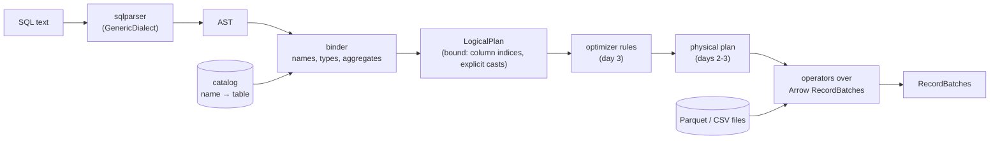

# Quarry design

Quarry is a SQL query engine for analytical queries over Parquet and CSV files, written in Rust on Apache Arrow
(arrow-rs). It reads files, it doesn't store data: no writes, no transactions, no indexes. The point is the middle of
a database, the part between a SQL string and its answer: parsing, name resolution and type checking, a logical
plan, optimizer rules, physical operators and vectorized evaluation over Arrow arrays.

This file is the specification. Where it says "an error", the binder returns `QuarryError::Plan` (the query is
wrong) or `QuarryError::Unsupported` (the query is valid SQL Quarry doesn't implement) and never panics.

## The pipeline



1. **Parse.** `sqlparser` turns the text into an AST with its `GenericDialect`. Quarry doesn't write a parser: SQL's
   grammar is large and well served by that crate; the interesting work starts after it.
2. **Bind.** The binder (`sql::Binder`) walks the AST of one `SELECT` with the catalog in hand. It resolves every
   name to a column of an input, gives every expression a type, inserts the casts that make both sides of an
   operator the same type, finds the aggregates and checks the grouping rules, and builds a `LogicalPlan`. Every
   error a user can make in a query is found here, before any data is read.
3. **Optimize** (day 3). Rules rewrite the logical plan: constant folding, projection pushdown into scans, predicate
   pushdown into Parquet row groups.
4. **Execute** (day 2, "Execution" below). Each node runs as a stream of Arrow `RecordBatch`es: scan, filter,
   projection, aggregate (by hashing), sort, limit; day 3 adds the hash join and a physical plan. Expressions evaluate
   a whole column at a time with Arrow's compute kernels.

## Data sources and the catalog

A table is anything that implements `TableProvider`:

```rust
pub trait TableProvider: Send + Sync + Debug {
    fn schema(&self) -> SchemaRef;                         // Arrow schema of every column
    fn scan(&self, projection: Option<&[usize]>, batch_size: usize) -> Result<BatchIter>;
    fn statistics(&self) -> TableStatistics;               // row count if known, Parquet row groups
}
```

`scan` returns an iterator of `RecordBatch`es holding only the projected columns, in projection order. Three
providers exist:

- **`ParquetTable`** reads a Parquet file with the `parquet` crate's Arrow reader. The schema comes from the file's
  footer. A projection becomes a `ProjectionMask` over the file's root columns, so unread columns are never
  decompressed. The footer's row groups (row count, and each column's min, max and null count when the writer
  recorded them) are kept in `statistics()`; day 3's predicate pushdown skips row groups with them.
- **`CsvTable`** reads a CSV file with `arrow-csv`. The file must have a header row. The schema is inferred from the
  first 1,000 rows by default: a column is `Int64` if every non-empty value parses as an integer, `Float64` if every
  value parses as a number, `Boolean` for `true`/`false`, `Date32` for `YYYY-MM-DD` when every one is a real
  date, and `Utf8` otherwise (date-times included: no expression takes a timestamp); an empty field is NULL. A schema can be given instead of inferred.
- **`MemTable`** holds record batches in memory, for tests.

The **catalog** maps table names to providers. Table names are matched without regard to case (`LineItem` and
`lineitem` are the same table); registering a second table under a name already taken is an error.

## Types

Quarry's types are Arrow's. Any column type can be scanned and passed through (`SELECT *` over a struct column
works); expressions are defined over these:

| Class | Arrow types | SQL spelling in `CAST` |
|---|---|---|
| boolean | `Boolean` | `BOOLEAN` |
| integer | `Int8`, `Int16`, `Int32`, `Int64`, `UInt8`, `UInt16`, `UInt32` | `SMALLINT` (Int16), `INT`/`INTEGER` (Int32), `BIGINT` (Int64) |
| float | `Float32`, `Float64` | `REAL` (Float32), `DOUBLE`/`FLOAT` (Float64) |
| string | `Utf8`, `LargeUtf8`, `Utf8View` | `VARCHAR`/`TEXT`/`STRING` (Utf8) |
| date | `Date32` (days since 1970-01-01) | `DATE` |
| null | `Null` (the type of the literal `NULL`) | |

An expression over any other type (`UInt64`, decimals, timestamps, lists, structs) is an `Unsupported` error naming
the type. `UInt64` is left out because no signed type holds all of it.

**Literals.** An integer literal is `Int64` (one that doesn't fit is an error); a number with a point or exponent is
`Float64`; a quoted string is `Utf8`; `TRUE`/`FALSE` are `Boolean`; `NULL` is `Null`; `DATE 'YYYY-MM-DD'` is
`Date32` (a malformed date is an error). A minus sign before a number is part of the literal, so
`-9223372036854775808` is an `Int64`. A double-quoted `"x"` is a name, not a string. `x::t` is `CAST(x AS t)`.

**The common type** of two types, used to make an operator's two sides the same:

1. the same type → itself;
2. `Null` and `T` → `T`;
3. two integers → `Int64`; an integer and a float, or two different floats → `Float64`;
4. two different string types → `Utf8`;
5. `Date32` and a string *literal* → `Date32`: the literal is parsed as a date when the query is bound (so
   `l_shipdate <= '1998-09-02'` works, as it does in DuckDB and PostgreSQL), and a string that isn't a date is an
   error;
6. anything else has no common type, and the operator is an error ("cannot compare Utf8 with Int64").

The binder makes every coercion an explicit `Cast` node in the plan, so execution never meets two different types
on one operator.

**Operators and their result types:**

| Operator | Operands | Result |
|---|---|---|
| `+ - *` | two numbers | their common type, widened to `Int64` or `Float64` |
| `/` | two numbers | `Float64`, always (as in DuckDB: `5 / 2` is 2.5) |
| `%` | two integers | `Int64` |
| `+ -` | `Date32` and an integer | `Date32` (days) |
| `-` | two `Date32` | `Int64` (days) |
| unary `-` | a number | the number's type, integers widened to `Int64` |
| `= <> < <= > >=` | two values with a common type | `Boolean` |
| `AND OR`, `NOT` | `Boolean` (or `NULL`) | `Boolean` |
| `IS [NOT] NULL` | anything | `Boolean`, never NULL |
| `\|\|` | two strings | `Utf8` |
| `[NOT] LIKE`, `[NOT] ILIKE` | two strings | `Boolean` |
| `[NOT] BETWEEN a AND b` | a common type of all three | `Boolean`; bound as `x >= a AND x <= b` (`NOT`: `x < a OR x > b`) |
| `[NOT] IN (list)` | a common type of all | `Boolean` |
| `CASE` | conditions `Boolean` (or the operand's common type, for `CASE x WHEN`) | the results' common type; no `ELSE` means `ELSE NULL` |
| `CAST(x AS t)` | when Arrow can cast the type to `t` | `t` |

**Aggregates:** `COUNT(*)` and `COUNT(x)` → `Int64`; `SUM` of integers → `Int64`, of floats → `Float64`; `AVG` →
`Float64` (its argument widens as `SUM`'s does, and the division is the last step, so integers above 2^53 aren't
rounded before they are added or deduplicated); `MIN`, `MAX` → the argument's type (numbers, strings, dates,
booleans). `COUNT(DISTINCT x)`, `SUM(DISTINCT x)` and the rest take `DISTINCT`. `SUM`, `AVG` need a number.

**NULL** follows SQL: an operator with a NULL operand is NULL, except `AND`/`OR` (three-valued logic: `FALSE AND
NULL` is `FALSE`, `TRUE OR NULL` is `TRUE`) and `IS NULL`. Aggregates skip NULLs; `COUNT(*)` counts rows. `WHERE` and
`HAVING` keep a row only when the predicate is `TRUE`.

## Names

Identifiers match without regard to case (by Unicode's lowercase mapping), quoted or not (`"L_ORDERKEY"` and `l_orderkey` are the same column), as
in DuckDB, which day 4 uses as the oracle. A table in `FROM` is known by its alias if it has one (`FROM lineitem AS
l` makes `l.l_quantity` valid and `lineitem.l_quantity` an error), otherwise by its name as the query spells it. A
bare column in the select list is named as the table spells it (`SELECT L_ORDERKEY` outputs `l_orderkey` if the file
says `l_orderkey`).

A column reference `c` resolves against the columns of every table in scope: no match is an error ("column c not
found; columns are ..."), more than one is an error ("column c is ambiguous: a.c, b.c"). `t.c` looks only in table
`t`. Two tables in one `FROM` with the same name or alias are an error. A type error names the whole expression as
written ("cannot compare Float64 with Utf8 ('big') in total > 'big'").

## The logical plan

A `LogicalPlan` is a tree of nodes. Each node knows its output schema: a list of fields, each with an optional
qualifier (the table it came from), a name, an Arrow type and nullability.

| Node | Output |
|---|---|
| `Scan { table, provider, projection }` | the table's columns (or the projected ones), qualified by the table's name or alias |
| `Empty { one_row }` | no columns; one row when `one_row` (for `SELECT 1 + 1` without `FROM`) |
| `Filter { input, predicate }` | the input's columns |
| `Projection { input, exprs }` | one column per expression, named by its alias |
| `Aggregate { input, group_by, aggregates }` | the group expressions, then the aggregates |
| `Join { left, right, kind, on }` | the left's columns, then the right's (right nullable for `LEFT`) |
| `Sort { input, keys }` | the input's columns |
| `Limit { input, skip, fetch }` | the input's columns |

Expressions in a node are **bound**: a column is an index into the node's input schema, not a name, and every
operator's operands already have the types it takes (one type on both sides, except date arithmetic). Names are resolved once, in the binder; after that, nothing looks
a name up, and two fields with the same name (`SELECT a.id, b.id`) are never confused. The plan prints as an
indented tree, the root first, expressions shown with their columns' names. An expression prints as SQL that binds
back to the same tree: parentheses follow sqlparser's precedence (OR < AND < NOT < IS < LIKE < comparisons, IN <
`+ -` < `* / % ||` < unary minus), a table's column is quoted when its name isn't a plain identifier or is reserved
(`w."x + 1"` is a column, `w.x + 1` an expression), and casts use Arrow's type names, which `CAST` accepts. A
computed column (an aggregate's output) prints as its own text, unquoted:

```
Limit: skip=0 fetch=10
  Sort: revenue DESC NULLS LAST
    Projection: lineitem.l_returnflag, sum(lineitem.l_extendedprice) AS revenue
      Aggregate: group_by=[lineitem.l_returnflag] aggregates=[sum(lineitem.l_extendedprice)]
        Filter: lineitem.l_shipdate <= DATE '1998-09-02'
          Scan: lineitem
```

## Binding a SELECT

The binder builds the plan from the bottom up, in SQL's logical order of evaluation:

1. **FROM.** Each table becomes a `Scan`. Tables separated by commas become a cross `Join`; `[INNER] JOIN ... ON`,
   `LEFT [OUTER] JOIN ... ON` and `CROSS JOIN` become `Join`s whose `ON` must be `Boolean`. No `FROM` gives
   `Empty { one_row: true }`. A subquery or a table function in `FROM` is unsupported.
2. **WHERE** is bound against the `FROM` scope; it must be `Boolean` (or `NULL`), and may not contain an aggregate
   ("aggregates are not allowed in WHERE").
3. **Aggregation.** The query aggregates if it has a `GROUP BY`, a `HAVING`, or an aggregate in its select list or
   `ORDER BY`. Then:
   - each `GROUP BY` item is an ordinal (`GROUP BY 1`, the first select item), an expression over the `FROM` scope,
     or, when a bare name isn't a `FROM` column at all (an ambiguous one still is), a select-list alias (two
     different items with that name are ambiguous); aggregates aren't allowed in it;
   - the aggregates are collected from the select list, `HAVING` and `ORDER BY`, each distinct one once; an aggregate
     inside an aggregate's argument is an error;
   - an `Aggregate` node is built, and every select, `HAVING` and `ORDER BY` expression is rewritten over its output:
     a subexpression equal to a group expression becomes that group column, an aggregate becomes its column, and a
     column left over that is neither grouped nor inside an aggregate is an error ("column l_tax must appear in GROUP
     BY or be used in an aggregate").
4. **HAVING** becomes a `Filter` over the `Aggregate`; `Boolean` again. It is bound like the select list, over the
   `FROM` scope, so it can't name a select-list alias (PostgreSQL's rule; DuckDB allows it).
5. **SELECT.** `*` expands to every column in scope and `t.*` to table `t`'s; each other item is bound and named by
   its alias, or by its column name when it is a bare column, or otherwise by its SQL text (`sum(l_quantity)`).
   Output names may repeat. An empty select list (`SELECT FROM t`, which sqlparser accepts) is an error.
6. **DISTINCT** becomes an `Aggregate` grouping by every output column, with no aggregates. `DISTINCT ON` is
   unsupported.
7. **ORDER BY.** Each key is, in this order of preference: an ordinal (`ORDER BY 2`; out of range is an error); a
   bare name equal to exactly one output column's name (more than one is an error); or an expression over the input
   of the projection. An expression equal to a select expression sorts by that column; any other is added to the
   projection as a hidden column (named `__order_0`, `__order_1`, ...), sorted by, and dropped by a final
   projection. A bare name inside an expression (`ORDER BY x + 1`) is never an output name. With `DISTINCT`, a key
   must be in the select list. `ASC` is the default; NULLs sort last in both directions unless `NULLS FIRST` says
   otherwise (DuckDB's default).
8. **LIMIT n OFFSET m** becomes `Limit { skip: m, fetch: n }`; both must be non-negative integer literals.
   `LIMIT NULL` is no limit, and `LIMIT m, n` (MySQL's order) is `OFFSET m LIMIT n`.

Unsupported, each an error naming it: subqueries anywhere, `WITH`, `UNION`/`INTERSECT`/`EXCEPT`, window functions,
`GROUPING SETS`/`ROLLUP`/`CUBE`, `USING`/`NATURAL` joins, `RIGHT`/`FULL` joins, intervals, expressions nested more
than 128 deep (`MAX_EXPR_DEPTH`: a chain of `OR`s is one level per operator, and binding, printing and dropping
recurse once per level), and statements other than
`SELECT` (and `EXPLAIN SELECT`, which prints the plan).

## Execution

`exec::execute(plan, batch_size)` runs a logical plan as it stands (day 3 puts a physical plan in between). Each node
becomes an iterator of Arrow `RecordBatch`es that pulls from its input's iterator, a batch at a time:

| Node | How it runs |
|---|---|
| `Scan` | the provider's `scan`, at most `batch_size` rows a batch |
| `Empty` | one batch of one row and no columns, or nothing |
| `Filter` | evaluates the predicate on each batch and keeps the rows where it is `TRUE` (Arrow's `filter`) |
| `Projection` | evaluates each expression on each batch |
| `Limit` | slices batches; once it has `fetch` rows it stops pulling, so the rest of the input is never read. Over projections it runs below them (a projection makes one row of each input row), so they compute only the rows it keeps |
| `Sort` | reads its whole input, evaluates the keys, sorts with Arrow's `lexsort`; the row number is the last key, so ties keep their input order |
| `Aggregate` | reads its whole input into a hash table of groups (below), then hands out one row per group |
| `Join` | a hash join on `ON`'s equalities, or a nested loop without any ("Joins" below); the right input is read whole, the left streams |

Every batch of the result is checked against the plan's output schema (types and nullability): a plan that claims a
column can't be NULL and then makes a NULL fails there, instead of returning a wrong answer. The result doesn't depend
on `batch_size`; the tests run every query at several. One exception, which DuckDB shares: whether a query that fails
on some row fails at all can depend on how far a LIMIT lets it read. `SELECT 10 % (id - 3) FROM t LIMIT 2` never
computes row 3 (the limit runs below the projection), but a filter computes its predicate for whole batches, so
`WHERE 10 % (id - 3) = 0 LIMIT 2` reaches row 3 only if it is in a batch the limit pulls. Under an `ORDER BY`, the
select list is computed for every row before the sort, so `SELECT CAST(s AS INT) FROM t ORDER BY id LIMIT 2` fails on
any row whose `s` isn't a number; DuckDB computes such an item after its top-N, for the kept rows only (it doesn't for
every expression: `10 % (id - 3)` fails there too). Day 3's top-k sort should do the same.

**Joins** (`exec/join.rs`, day 3). `ON` is split into its conjuncts (the operands of a chain of `AND`s). A conjunct
`l = r` is a **key** when `l` reads only left columns and `r` only right columns (or the other way round), each at
least one; every other conjunct is the **residual**, kept in its order. The right input is the build side: it is read
whole, and with keys its rows are grouped by key in a hash table (the keys in Arrow's row format with floats
normalized, as for GROUP BY, so -0.0 meets 0.0 and NaN meets NaN; a row with a NULL key goes in no group, since NULL
equals nothing). Each left row looks up its candidates, the build rows with its key, in their input order; with no
keys every build row is a candidate (a nested loop, as for `CROSS JOIN` and `ON o.qty > c.rank`). The residual is
evaluated on the candidate pairs, at most `batch_size` pairs at a time, and the pairs where it is TRUE come out. A
`LEFT` join's left row with no such pair comes out once, with NULLs on the right, in its place.

So the output is in the left input's order, each left row's matches in the build side's order, whatever the batch
size, and the tests can compare joins row for row. The residual is computed only for pairs with equal keys: the join
alone never computes `ON o.customer = c.name AND 5 % (c.rank - 4) = 1`'s division for a customer no order names,
where `ON 5 % (c.rank - 4) = 1` alone (a nested loop) does and fails. (The optimizer then moves that condition, which
reads the right side only, below the join, where it does fail, as on DuckDB 2.0: "The optimizer" below.) An inner join whose build side has no rows doesn't
read its left input at all. The build side is always the right input; choosing the smaller side would need the
output order to stop being the left's.

**Expressions** (`exec::evaluate`) are computed a column at a time with Arrow's compute kernels. A literal stays a
one-row scalar until an operator needs a column (Arrow's kernels take a column and a scalar), so `l_quantity < 24`
doesn't build a column of 24s, and an expression of literals alone is computed once a batch. Over a batch of no rows
an expression isn't computed at all: `9223372036854775807 + 1` fails only when a row needs it, as it would row by row.

Three operators are **lazy**, as in DuckDB: `AND` evaluates its right side only on the rows where the left isn't
`FALSE`, `OR` only where it isn't `TRUE`, and each `CASE` branch only on the rows that reach it. That is what makes
`b <> 0 AND a % b = 1` and `CASE WHEN b = 0 THEN 0 ELSE a % b END` safe: the modulo never sees a zero. The rows still
undecided are taken out of the batch (`take`), the operand is evaluated on them, and the results are put back in
place (`interleave`).

**The rules where SQL engines differ** follow DuckDB 2.0.0, the oracle day 4 compares against; each was checked on
DuckDB by hand:

| Case | Quarry (and DuckDB 2.0) |
|---|---|
| integer `+ - *`, unary minus overflowing Int64 | an error ("overflow in ...") |
| `x % 0` | an error ("division by zero in ...") |
| `i64::MIN % -1` | an error (it overflows in the division; Arrow's kernel returns 0) |
| `x / 0`, `0 / 0` | `inf` (or `-inf`) and `NaN`: `/` is always Float64, and floats follow IEEE 754 |
| a float cast to an integer | rounds half to even (`CAST(2.5 AS BIGINT)` is 2, `3.5` is 4); Arrow truncates, so Quarry rounds first |
| a cast that fails (`CAST('abc' AS INT)`, `CAST(300 AS SMALLINT)`, NaN to BIGINT) | an error, never NULL (Arrow's "safe" mode would make NULLs; the plan's nullability assumes casts don't) |
| `-0.0 = 0.0`, `NaN = NaN` | both `TRUE`; NaN is greater than every other number. Arrow's kernels order floats by IEEE 754's total order, which tells -0.0 from 0.0 and one NaN from another, so floats are normalized (-0.0 to 0.0, every NaN to one NaN) before comparisons, grouping, DISTINCT, MIN/MAX and sorting. What comes out is still a value from the input: a group's key is its first row's (-0.0 stays -0.0), MIN and MAX the winning value, the last of equal ones (DuckDB's choices) |
| strings | compared and sorted by their UTF-8 bytes (`'B' < 'a' < 'é'`) |
| `LIKE` | no escape character: a backslash is an ordinary character (Arrow's kernel treats `\` as an escape, so Quarry doubles each one); `%` and `_` match newlines; `ILIKE` folds Unicode case |
| `'a' \|\| NULL` | NULL |
| `x IN (1, NULL)` | `TRUE` if `x` is 1, else NULL (three-valued, as `x = 1 OR x = NULL`) |
| date `+`/`-` days | a date; past Date32's range (about 5.8 million years either way) an error, where DuckDB's dates reach further |

**Aggregation.** Rows are grouped by their group keys encoded in Arrow's row format: bytes that compare and hash as
the values do, for any types and any number of keys, so one `HashMap<bytes, group number>` is the whole grouping (the
floats normalized first, so -0.0 and 0.0 are one group and NaNs another, as in DuckDB; NULL is a group of its own).
The key a group outputs is its first row's, as it was.
Each aggregate keeps an accumulator with a slot per group:

| Aggregate | State per group | Result |
|---|---|---|
| `COUNT(*)`, `COUNT(x)` | a count of rows, or of non-NULL values | Int64, 0 for no rows |
| `SUM`, `AVG` of integers | an i128 sum and a count | SUM: Int64, an error if the total doesn't fit (DuckDB's SUM returns a 128-bit HUGEINT instead); AVG: the sum divided by the count, as Float64, at the end |
| `SUM`, `AVG` of floats | an f64 sum and a count | Float64 |
| `MIN`, `MAX` | the best value's row-format bytes, normalized (to compare) and as it was (to output); the last of equal values wins | the argument's type, decoded from the bytes |
| `agg(DISTINCT x)` | the (group, value) pairs seen | the aggregate over each group's first occurrence of each value; MIN and MAX ignore DISTINCT, which doesn't change them |

`SUM`, `AVG`, `MIN` and `MAX` of no values are NULL. Without a `GROUP BY` there is exactly one group, even over no
rows (`SELECT count(*) FROM t WHERE FALSE` is one row, 0); with one, no rows make no groups.

## The optimizer

`optimizer::optimize` (day 3) rewrites the bound plan; `quarry::query` and the CLI run what it returns. Three rules
run once each, in order. Each keeps the plan's output columns (names, types, order), and `tests/execute.rs` runs
every query bound and optimized, at every batch size, and requires the same rows (or the same error).

1. **Constant folding** (`optimizer/fold.rs`). A subexpression that reads no column is computed once, over a single
   row, and replaced by its value (`a + (1 + 2) * 3` is `a + 9`), largest first. A constant that fails (`7 % 0`,
   `CAST('x' AS INT)`) stays as it is, with its operands folded, to fail only if a row reaches it, as it would
   without the rule: `CASE WHEN a > 0 THEN 1 ELSE 7 % 0 END` over positive `a`s gives 1s. A value whose type no
   literal holds (an `INT`, a `REAL`) stays computed. Then `AND` and `OR` with a constant operand are simplified where
   that changes nothing computed: they are lazy, so `FALSE AND x` is FALSE without computing `x`, and `TRUE AND x`
   and `x AND TRUE` are `x`; `x AND FALSE` stays, since `x` is computed on every row and may fail. A filter that is
   then TRUE goes away; one that is FALSE or NULL becomes `Empty: no rows`, and its input isn't read.
2. **Predicate pushdown** (`optimizer/predicates.rs`). A filter over an inner or cross join joins its `ON` (for an
   inner join they mean the same; a cross join with an `ON` is an inner join, so `FROM t, u WHERE t.a = u.a` is a
   hash join). The `ON`'s conjuncts that read one side only become a filter on that side, the `ON`'s own first, then
   the `WHERE`'s; the rest stay in the `ON`. Over a `LEFT` join, `WHERE`'s conjuncts on the left go down to the left
   (a left row they drop would only make rows they drop) and the others stay above (they see the NULLs of unmatched
   rows); of its `ON`, conjuncts on the right go down to the right (a build row they reject can't match) and those on
   the left stay (they decide matching, not which left rows come out). Conjuncts that land in one place keep their
   order. A condition that fails on some row is then computed on rows the original order wouldn't have reached:
   `JOIN customers c ON o.customer = c.name AND 5 % (c.rank - 4) = 1` divides by zero for the customer no order
   names, because the condition now filters every customer. DuckDB 2.0 moves conditions the same way and fails the
   same queries (each case checked by hand).
3. **Projection pushdown** (`optimizer/columns.rs`). Walking down from the root with the columns each node's parent
   needs, every scan gets a projection of what is used above it, and every expression above a narrowed scan is
   renumbered (bound expressions refer to columns by position). `SELECT count(*) FROM t` reads no column at all,
   only row counts. Projections and aggregates keep all their outputs (an unused one is still computed), so only
   scans drop columns. It runs last because it renumbers.

`EXPLAIN` (in `quarry query`) prints the optimized plan, which is what runs; `quarry plan` prints the bound plan.

## The days

- **Day 1:** the workspace, the readers and the catalog, the logical plan, the binder, a CLI that prints
  a file's schema, its rows, and a query's plan; CI.
- **Day 2:** execution of projection, filter, aggregate (with `GROUP BY`), sort and limit, and vectorized
  expression evaluation over Arrow arrays ("Execution" above); `quarry query`.
- **Day 3:** physical operators (hash aggregate, hash join, sort), predicate pushdown into Parquet row groups,
  optimizer rules (constant folding, projection pushdown).
- **Day 4:** TPC-H-style queries over generated data; differential tests against DuckDB (Python `duckdb` as the
  oracle); criterion benchmarks.
- **Day 5:** a REPL, the README's results, WALKTHROUGH.md, v1.0.0.

## Testing

- **Readers:** files written in the tests (Parquet by `ArrowWriter` with small row groups, CSV by hand) read back
  equal, with projections, empty files, NULLs, and the inferred CSV types above.
- **Binder:** each rule in this file has a test that binds a query and compares the printed plan, or checks the error
  and its message. Every expression the binder builds is checked to have the type the table above gives it.
- **No panics:** a property test generates random expressions from a grammar of the supported SQL (columns of each
  type, literals, every operator) and binds them; the binder must return a plan or an error, never panic, and a
  plan's types must equal an independent type function's.
- **Evaluation (day 2):** a property test generates well-typed expressions over random rows (NULLs, i64::MIN and
  MAX, -0.0, NaN, infinities, backslashes, newlines) and evaluates each with the engine and with a reference
  interpreter in the test that applies this file's rules one row at a time; the values must be equal, or both must
  fail, and splitting the rows into batches mustn't change them. A second one does the same for random `GROUP BY`
  queries against a reference grouping in plain Rust. Every query in `tests/execute.rs` runs at batch sizes 1, 2, 3
  and 8192, over memory, CSV and Parquet, and must give the same rows.
- **Against DuckDB (day 4):** TPC-H-style queries over generated files, each result compared with DuckDB's. Day 2's
  rules above were checked against DuckDB 2.0.0 by hand.
