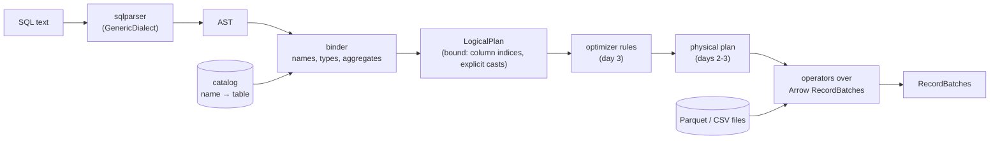

# Quarry design

Quarry is a SQL query engine for analytical queries over Parquet and CSV files, written in Rust on Apache Arrow
(arrow-rs). It reads files, it doesn't store data: no writes, no transactions, no indexes. The point is the middle of
a database, the part between a SQL string and its answer: parsing, name resolution and type checking, a logical
plan, optimizer rules, physical operators and vectorized evaluation over Arrow arrays.

This file is the specification. Where it says "an error", the binder returns `QuarryError::Plan` (the query is
wrong) or `QuarryError::Unsupported` (the query is valid SQL Quarry doesn't implement) and never panics.

## The pipeline



1. **Parse.** `sqlparser` turns the text into an AST with its `GenericDialect`. Quarry doesn't write a parser: SQL's
   grammar is large and well served by that crate; the interesting work starts after it.
2. **Bind.** The binder (`sql::Binder`) walks the AST of one `SELECT` with the catalog in hand. It resolves every
   name to a column of an input, gives every expression a type, inserts the casts that make both sides of an
   operator the same type, finds the aggregates and checks the grouping rules, and builds a `LogicalPlan`. Every
   error a user can make in a query is found here, before any data is read.
3. **Optimize** (day 3). Rules rewrite the logical plan: constant folding, projection pushdown into scans, predicate
   pushdown into Parquet row groups.
4. **Execute** (days 2–3). A physical plan of operators, each a stream of Arrow `RecordBatch`es: scan, filter,
   projection, hash aggregate, hash join, sort, limit. Expressions evaluate a whole column at a time with Arrow's
   compute kernels.

## Data sources and the catalog

A table is anything that implements `TableProvider`:

```rust
pub trait TableProvider: Send + Sync + Debug {
    fn schema(&self) -> SchemaRef;                         // Arrow schema of every column
    fn scan(&self, projection: Option<&[usize]>, batch_size: usize) -> Result<BatchIter>;
    fn statistics(&self) -> TableStatistics;               // row count if known, Parquet row groups
}
```

`scan` returns an iterator of `RecordBatch`es holding only the projected columns, in projection order. Three
providers exist:

- **`ParquetTable`** reads a Parquet file with the `parquet` crate's Arrow reader. The schema comes from the file's
  footer. A projection becomes a `ProjectionMask` over the file's root columns, so unread columns are never
  decompressed. The footer's row groups (row count, and each column's min, max and null count when the writer
  recorded them) are kept in `statistics()`; day 3's predicate pushdown skips row groups with them.
- **`CsvTable`** reads a CSV file with `arrow-csv`. The file must have a header row. The schema is inferred from the
  first 1,000 rows by default: a column is `Int64` if every non-empty value parses as an integer, `Float64` if every
  value parses as a number, `Boolean` for `true`/`false`, `Date32` for `YYYY-MM-DD`, and `Utf8` otherwise; an
  empty field is NULL. A schema can be given instead of inferred.
- **`MemTable`** holds record batches in memory, for tests.

The **catalog** maps table names to providers. Table names are matched without regard to case (`LineItem` and
`lineitem` are the same table); registering a second table under a name already taken is an error.

## Types

Quarry's types are Arrow's. Any column type can be scanned and passed through (`SELECT *` over a struct column
works); expressions are defined over these:

| Class | Arrow types | SQL spelling in `CAST` |
|---|---|---|
| boolean | `Boolean` | `BOOLEAN` |
| integer | `Int8`, `Int16`, `Int32`, `Int64`, `UInt8`, `UInt16`, `UInt32` | `SMALLINT` (Int16), `INT`/`INTEGER` (Int32), `BIGINT` (Int64) |
| float | `Float32`, `Float64` | `REAL` (Float32), `DOUBLE`/`FLOAT` (Float64) |
| string | `Utf8`, `LargeUtf8`, `Utf8View` | `VARCHAR`/`TEXT`/`STRING` (Utf8) |
| date | `Date32` (days since 1970-01-01) | `DATE` |
| null | `Null` (the type of the literal `NULL`) | |

An expression over any other type (`UInt64`, decimals, timestamps, lists, structs) is an `Unsupported` error naming
the type. `UInt64` is left out because no signed type holds all of it.

**Literals.** An integer literal is `Int64` (one that doesn't fit is an error); a number with a point or exponent is
`Float64`; a quoted string is `Utf8`; `TRUE`/`FALSE` are `Boolean`; `NULL` is `Null`; `DATE 'YYYY-MM-DD'` is
`Date32` (a malformed date is an error). A minus sign before a number is part of the literal, so
`-9223372036854775808` is an `Int64`. A double-quoted `"x"` is a name, not a string. `x::t` is `CAST(x AS t)`.

**The common type** of two types, used to make an operator's two sides the same:

1. the same type → itself;
2. `Null` and `T` → `T`;
3. two integers → `Int64`; an integer and a float, or two different floats → `Float64`;
4. two different string types → `Utf8`;
5. `Date32` and a string *literal* → `Date32`: the literal is parsed as a date when the query is bound (so
   `l_shipdate <= '1998-09-02'` works, as it does in DuckDB and PostgreSQL), and a string that isn't a date is an
   error;
6. anything else has no common type, and the operator is an error ("cannot compare Utf8 with Int64").

The binder makes every coercion an explicit `Cast` node in the plan, so execution never meets two different types
on one operator.

**Operators and their result types:**

| Operator | Operands | Result |
|---|---|---|
| `+ - *` | two numbers | their common type, widened to `Int64` or `Float64` |
| `/` | two numbers | `Float64`, always (as in DuckDB: `5 / 2` is 2.5) |
| `%` | two integers | `Int64` |
| `+ -` | `Date32` and an integer | `Date32` (days) |
| `-` | two `Date32` | `Int64` (days) |
| unary `-` | a number | the number's type, integers widened to `Int64` |
| `= <> < <= > >=` | two values with a common type | `Boolean` |
| `AND OR`, `NOT` | `Boolean` (or `NULL`) | `Boolean` |
| `IS [NOT] NULL` | anything | `Boolean`, never NULL |
| `\|\|` | two strings | `Utf8` |
| `[NOT] LIKE`, `[NOT] ILIKE` | two strings | `Boolean` |
| `[NOT] BETWEEN a AND b` | a common type of all three | `Boolean`; bound as `x >= a AND x <= b` (`NOT`: `x < a OR x > b`) |
| `[NOT] IN (list)` | a common type of all | `Boolean` |
| `CASE` | conditions `Boolean` (or the operand's common type, for `CASE x WHEN`) | the results' common type; no `ELSE` means `ELSE NULL` |
| `CAST(x AS t)` | when Arrow can cast the type to `t` | `t` |

**Aggregates:** `COUNT(*)` and `COUNT(x)` → `Int64`; `SUM` of integers → `Int64`, of floats → `Float64`; `AVG` →
`Float64` (its argument widens as `SUM`'s does, and the division is the last step, so integers above 2^53 aren't
rounded before they are added or deduplicated); `MIN`, `MAX` → the argument's type (numbers, strings, dates,
booleans). `COUNT(DISTINCT x)`, `SUM(DISTINCT x)` and the rest take `DISTINCT`. `SUM`, `AVG` need a number.

**NULL** follows SQL: an operator with a NULL operand is NULL, except `AND`/`OR` (three-valued logic: `FALSE AND
NULL` is `FALSE`, `TRUE OR NULL` is `TRUE`) and `IS NULL`. Aggregates skip NULLs; `COUNT(*)` counts rows. `WHERE` and
`HAVING` keep a row only when the predicate is `TRUE`.

## Names

Identifiers match without regard to case (by Unicode's lowercase mapping), quoted or not (`"L_ORDERKEY"` and `l_orderkey` are the same column), as
in DuckDB, which day 4 uses as the oracle. A table in `FROM` is known by its alias if it has one (`FROM lineitem AS
l` makes `l.l_quantity` valid and `lineitem.l_quantity` an error), otherwise by its name as the query spells it. A
bare column in the select list is named as the table spells it (`SELECT L_ORDERKEY` outputs `l_orderkey` if the file
says `l_orderkey`).

A column reference `c` resolves against the columns of every table in scope: no match is an error ("column c not
found; columns are ..."), more than one is an error ("column c is ambiguous: a.c, b.c"). `t.c` looks only in table
`t`. Two tables in one `FROM` with the same name or alias are an error. A type error names the whole expression as
written ("cannot compare Float64 with Utf8 ('big') in total > 'big'").

## The logical plan

A `LogicalPlan` is a tree of nodes. Each node knows its output schema: a list of fields, each with an optional
qualifier (the table it came from), a name, an Arrow type and nullability.

| Node | Output |
|---|---|
| `Scan { table, provider, projection }` | the table's columns (or the projected ones), qualified by the table's name or alias |
| `Empty { one_row }` | no columns; one row when `one_row` (for `SELECT 1 + 1` without `FROM`) |
| `Filter { input, predicate }` | the input's columns |
| `Projection { input, exprs }` | one column per expression, named by its alias |
| `Aggregate { input, group_by, aggregates }` | the group expressions, then the aggregates |
| `Join { left, right, kind, on }` | the left's columns, then the right's (right nullable for `LEFT`) |
| `Sort { input, keys }` | the input's columns |
| `Limit { input, skip, fetch }` | the input's columns |

Expressions in a node are **bound**: a column is an index into the node's input schema, not a name, and every
operator's operands already have the types it takes (one type on both sides, except date arithmetic). Names are resolved once, in the binder; after that, nothing looks
a name up, and two fields with the same name (`SELECT a.id, b.id`) are never confused. The plan prints as an
indented tree, the root first, expressions shown with their columns' names:

```
Limit: skip=0 fetch=10
  Sort: revenue DESC NULLS LAST
    Projection: lineitem.l_returnflag, sum(lineitem.l_extendedprice) AS revenue
      Aggregate: group_by=[lineitem.l_returnflag] aggregates=[sum(lineitem.l_extendedprice)]
        Filter: lineitem.l_shipdate <= DATE '1998-09-02'
          Scan: lineitem
```

## Binding a SELECT

The binder builds the plan from the bottom up, in SQL's logical order of evaluation:

1. **FROM.** Each table becomes a `Scan`. Tables separated by commas become a cross `Join`; `[INNER] JOIN ... ON`,
   `LEFT [OUTER] JOIN ... ON` and `CROSS JOIN` become `Join`s whose `ON` must be `Boolean`. No `FROM` gives
   `Empty { one_row: true }`. A subquery or a table function in `FROM` is unsupported.
2. **WHERE** is bound against the `FROM` scope; it must be `Boolean` (or `NULL`), and may not contain an aggregate
   ("aggregates are not allowed in WHERE").
3. **Aggregation.** The query aggregates if it has a `GROUP BY`, a `HAVING`, or an aggregate in its select list or
   `ORDER BY`. Then:
   - each `GROUP BY` item is an ordinal (`GROUP BY 1`, the first select item), an expression over the `FROM` scope,
     or, when a bare name isn't a `FROM` column at all (an ambiguous one still is), a select-list alias (two
     different items with that name are ambiguous); aggregates aren't allowed in it;
   - the aggregates are collected from the select list, `HAVING` and `ORDER BY`, each distinct one once; an aggregate
     inside an aggregate's argument is an error;
   - an `Aggregate` node is built, and every select, `HAVING` and `ORDER BY` expression is rewritten over its output:
     a subexpression equal to a group expression becomes that group column, an aggregate becomes its column, and a
     column left over that is neither grouped nor inside an aggregate is an error ("column l_tax must appear in GROUP
     BY or be used in an aggregate").
4. **HAVING** becomes a `Filter` over the `Aggregate`; `Boolean` again. It is bound like the select list, over the
   `FROM` scope, so it can't name a select-list alias (PostgreSQL's rule; DuckDB allows it).
5. **SELECT.** `*` expands to every column in scope and `t.*` to table `t`'s; each other item is bound and named by
   its alias, or by its column name when it is a bare column, or otherwise by its SQL text (`sum(l_quantity)`).
   Output names may repeat. An empty select list (`SELECT FROM t`, which sqlparser accepts) is an error.
6. **DISTINCT** becomes an `Aggregate` grouping by every output column, with no aggregates. `DISTINCT ON` is
   unsupported.
7. **ORDER BY.** Each key is, in this order of preference: an ordinal (`ORDER BY 2`; out of range is an error); a
   bare name equal to exactly one output column's name (more than one is an error); or an expression over the input
   of the projection. An expression equal to a select expression sorts by that column; any other is added to the
   projection as a hidden column (named `__order_0`, `__order_1`, ...), sorted by, and dropped by a final
   projection. A bare name inside an expression (`ORDER BY x + 1`) is never an output name. With `DISTINCT`, a key
   must be in the select list. `ASC` is the default; NULLs sort last in both directions unless `NULLS FIRST` says
   otherwise (DuckDB's default).
8. **LIMIT n OFFSET m** becomes `Limit { skip: m, fetch: n }`; both must be non-negative integer literals.
   `LIMIT NULL` is no limit, and `LIMIT m, n` (MySQL's order) is `OFFSET m LIMIT n`.

Unsupported, each an error naming it: subqueries anywhere, `WITH`, `UNION`/`INTERSECT`/`EXCEPT`, window functions,
`GROUPING SETS`/`ROLLUP`/`CUBE`, `USING`/`NATURAL` joins, `RIGHT`/`FULL` joins, intervals, expressions nested more
than 128 deep (`MAX_EXPR_DEPTH`: a chain of `OR`s is one level per operator, and binding, printing and dropping
recurse once per level), and statements other than
`SELECT` (and `EXPLAIN SELECT`, which prints the plan).

## The days

- **Day 1 (this file):** the workspace, the readers and the catalog, the logical plan, the binder, a CLI that prints
  a file's schema, its rows, and a query's plan; CI.
- **Day 2:** execution of projection, filter, aggregate (with `GROUP BY`), sort and limit, and vectorized
  expression evaluation over Arrow arrays.
- **Day 3:** physical operators (hash aggregate, hash join, sort), predicate pushdown into Parquet row groups,
  optimizer rules (constant folding, projection pushdown).
- **Day 4:** TPC-H-style queries over generated data; differential tests against DuckDB (Python `duckdb` as the
  oracle); criterion benchmarks.
- **Day 5:** a REPL, the README's results, WALKTHROUGH.md, v1.0.0.

## Testing

- **Readers:** files written in the tests (Parquet by `ArrowWriter` with small row groups, CSV by hand) read back
  equal, with projections, empty files, NULLs, and the inferred CSV types above.
- **Binder:** each rule in this file has a test that binds a query and compares the printed plan, or checks the error
  and its message. Every expression the binder builds is checked to have the type the table above gives it.
- **No panics:** a property test generates random expressions from a grammar of the supported SQL (columns of each
  type, literals, every operator) and binds them; the binder must return a plan or an error, never panic, and a
  plan's types must equal an independent type function's.
- From day 2, every query result is compared with DuckDB's on the same files.
