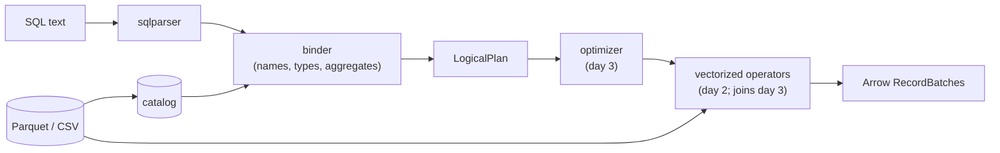

# Quarry

A SQL query engine over Parquet and CSV files, written in Rust on Apache Arrow (arrow-rs). It takes a SQL string,
resolves every name and type against the files' schemas, builds a logical plan, and executes it with vectorized
operators over Arrow record batches.

**Status: day 2 of 5.** The readers, the catalog, the logical plan, the binder (SQL to a typed plan) and the
executor (filter, projection, aggregate with GROUP BY and DISTINCT, sort, limit, and vectorized expressions) are done
and tested; `quarry query` runs a query over files. Joins bind but don't run yet. Day 3 adds hash joins, predicate
pushdown and optimizer rules; day 4 TPC-H-style queries checked against DuckDB, and benchmarks; day 5 a REPL and the
release.

## Why

The interesting part of a database is the middle: how `SELECT customer, sum(total) ... GROUP BY customer HAVING
count(*) > 1 ORDER BY 2` becomes a tree of operators that means exactly what the SQL says. Quarry builds that middle
by hand (binder, plan, optimizer, operators) and borrows the two ends that aren't the point: `sqlparser` for the
grammar and Arrow for the columnar memory format and its compute kernels.

## Architecture



- **Readers** (`crates/quarry/src/datasource/`): a `TableProvider` trait (schema, scan with a projection and batch
  size, statistics) with three tables. `ParquetTable` reads the footer once and decodes only projected columns;
  `CsvTable` infers a schema from the first 1,000 rows; `MemTable` holds batches for tests.
- **Catalog** (`catalog.rs`): table names, matched without regard to case.
- **Logical plan** (`plan/`): Scan, Empty, Filter, Projection, Aggregate, Join, Sort, Limit. Expressions are
  *bound*: a column is an index into the node's input, and every coercion is an explicit `Cast`.
- **Binder** (`sql/`): one SELECT, clause by clause in SQL's logical order (FROM, WHERE, GROUP BY and aggregates,
  HAVING, the select list, DISTINCT, ORDER BY, LIMIT). Every mistake a query can contain is reported here, before
  any data is read.
- **Executor** (`exec/mod.rs`): each plan node is an iterator of record batches pulling from its input's. Filter,
  projection and limit stream (a LIMIT stops reading once it has its rows); sort and aggregate drain their input.
  Every result batch is checked against the plan's types and nullability.
- **Expressions** (`exec/expr.rs`): a column at a time with Arrow's kernels, literals kept as scalars; `AND`, `OR`
  and `CASE` evaluate later operands only on the rows still undecided, so `b <> 0 AND a % b = 1` never divides by
  zero. Overflow, `% 0` and failed casts are errors, as in DuckDB 2.0.
- **Aggregation** (`exec/aggregate.rs`): group keys encoded in Arrow's row format and hashed; one accumulator per
  aggregate (integer sums in i128); `DISTINCT` by remembering (group, value) pairs.

DESIGN.md is the specification: the type rules, name resolution, each node, the eight binding steps, and execution
(each rule where engines differ, checked on DuckDB 2.0).

## Layout

```
crates/quarry/          the engine (a library)
  src/datasource/       TableProvider; Parquet, CSV and in-memory tables
  src/catalog.rs        table names to tables
  src/types.rs          type classes, the common-type rules, strict dates
  src/plan/             LogicalPlan, bound Expr, printing
  src/sql/              parsing and the binder
  src/exec/             the executor: operators (mod.rs), expressions (expr.rs), aggregation (aggregate.rs)
  tests/                datasource.rs, binder.rs, binder_properties.rs, execute.rs, eval_properties.rs,
                        aggregate_properties.rs
  examples/             gen_orders.rs (synthetic Parquet data), time_queries.rs (the timings below)
crates/quarry-cli/      the `quarry` binary and its tests
examples/orders.csv     eight synthetic rows for the examples below
DESIGN.md               the specification
```

## Try it

```bash
cargo build --release
```

```bash
./target/release/quarry schema examples/orders.csv
```

```
order_id: Int64
customer: Utf8
status: Utf8
total: Float64
placed: Date32
```

`quarry plan` binds a query against files and prints the plan (`-t PATH` names the table after the file, or `-t
NAME=PATH`):

```bash
./target/release/quarry plan -t examples/orders.csv "SELECT customer, count(*) AS orders, sum(total) AS spent FROM orders WHERE status <> 'cancelled' AND placed >= '2024-01-01' GROUP BY customer HAVING count(*) > 1 ORDER BY spent DESC LIMIT 3"
```

```
Limit: skip=0 fetch=3
  Sort: spent DESC NULLS LAST
    Projection: orders.customer, count(*) AS orders, sum(orders.total) AS spent
      Filter: count(*) > 1
        Aggregate: group_by=[orders.customer] aggregates=[count(*), sum(orders.total)]
          Filter: orders.status <> 'cancelled' AND orders.placed >= DATE '2024-01-01'
            Scan: orders
```

The string `'2024-01-01'` became a `DATE` because it is compared with a date column; `count(*)` in `HAVING` is the
same aggregate as in the select list, so the Aggregate computes it once. `quarry query` runs it:

```bash
./target/release/quarry query -t examples/orders.csv "SELECT customer, count(*) AS orders, sum(total) AS spent FROM orders WHERE status <> 'cancelled' AND placed >= '2024-01-01' GROUP BY customer HAVING count(*) > 1 ORDER BY spent DESC LIMIT 3"
```

```
+----------+--------+--------+
| customer | orders | spent  |
+----------+--------+--------+
| bo       | 2      | 275.0  |
| ada      | 3      | 202.85 |
+----------+--------+--------+
2 rows
```

A query that doesn't make sense fails before anything is read, with status 1:

```bash
./target/release/quarry plan -t examples/orders.csv "SELECT customer FROM orders WHERE total > 'big'"
```

```
error: plan error: cannot compare Float64 with Utf8 ('big') in total > 'big'
```

`quarry head -n 3 examples/orders.csv` prints rows; `quarry --help` lists the rest.

## Tests

`make check` runs rustfmt, Clippy with warnings as errors, every test, and the docs with no broken links; CI runs
it on Linux (ubuntu-24.04) and macOS (macos-15) on every push.

| Suite | What it checks |
|---|---|
| `tests/datasource.rs` (22) | Parquet and CSV files written in the test read back equal; projections in any order and with repeats; empty projections still count rows; batch sizes (0 included); inferred CSV types, NULLs, timestamps and impossible dates; the catalog's names |
| `tests/binder.rs` (41) | each binding rule in DESIGN.md: the printed plan, or the error and its message; the review's findings; the depth limit on a 2 MiB stack |
| `tests/binder_properties.rs` (3) | random expressions against a model of the type rules (below) |
| `tests/execute.rs` (14) | queries end to end at batch sizes 1, 2, 3 and 8192 (which must agree): filters, projections, ORDER BY (NULLs, -0.0, ties, hidden keys), LIMIT/OFFSET and that a LIMIT stops reading, every aggregate, GROUP BY expressions, HAVING, DISTINCT, aggregates over no rows, float groups, i128 sums, errors; the same queries over CSV and Parquet files |
| `tests/eval_properties.rs` (3) | random well-typed expressions over random rows, evaluated by the engine and by a row-at-a-time reference interpreter in the test (below) |
| `tests/aggregate_properties.rs` (2) | random GROUP BY queries at random batch sizes against a reference grouping in plain Rust |
| unit tests (28) | the common-type rules, date parsing over every day from 1600 to 2400 and against Arrow's own cast, expression printing, the plan nodes' guards and schemas; each operator of the evaluator, with DuckDB 2.0's answers |
| `quarry-cli/tests/cli.rs` (9) | the built binary: output, exit codes, errors on stderr, `quarry query`, and that this README's examples print what it says |

The property tests bind `SELECT <expr> FROM t` for expressions from two generators (a random grammar of every
supported operator, mostly ill-typed, and a type-directed one that builds well-typed trees three operators deep)
and compare each with a model in the test that re-reads DESIGN.md's rules without sharing code with the binder. An
expression the model types must bind to exactly that type and nullability; one it refuses must fail with an error;
nothing may panic; every bound operator must see one type on both sides; and the printed expression must bind back
to the same tree. Mutating the binder (dropping its casts, integer division, a wrong nullability, LIKE's printing
precedence) fails them. `PROPTEST_CASES=100000 cargo test --release -p quarry --test binder_properties` searches
longer (about 5 s here); CI's Linux job runs that on every push.

The evaluator's property test generates well-typed SQL expressions (every operator, `CASE`, `IN`, `LIKE`, casts,
date arithmetic) over random rows full of edge values (i64::MIN and MAX, -0.0, NaN, infinity, backslashes, newlines)
and evaluates each with the engine and with an interpreter in the test that applies DESIGN.md's rules one row at a
time over plain Rust values. The two must agree on every value, floats bit for bit, or both fail, and two slices of
the batch must give the same as the whole. The GROUP BY property does the same for random queries (no key, or one or
two of four columns; one to four aggregates, each maybe DISTINCT) against a grouping in plain Rust. Twelve mutations
of the engine (six in the evaluator, six in aggregation) each fail one of them. CI runs both at 100,000 cases.

## Review of day 1

One review agent read the day's code at `6a48287` against DESIGN.md (19 minutes, in its own worktree) and saved
each bug it reproduced as a failing test. It found 10; each is fixed, and its test, adapted, is in the suites above:

| Finding | Fix |
|---|---|
| `GROUP BY a` with `a` an ambiguous FROM column fell back to a select alias | the alias is only for names no FROM column has |
| `SELECT DISTINCT FROM t` and `SELECT FROM t HAVING TRUE` bound to the same plan, which need 0 and 1 rows | an empty select list is an error |
| `avg(DISTINCT a)` deduplicated `CAST(a AS Float64)`: 2^53 and 2^53 + 1 counted once | AVG's argument widens as SUM's does; the division is last |
| a 5,000-term `OR` chain overflowed the stack and aborted the process | expressions nest at most 128 deep (`MAX_EXPR_DEPTH`) |
| `-x` on a Float32 came out Float64 | floats keep their type |
| `(s LIKE 'a') = flag` printed as `s LIKE 'a' = flag`, which parses differently | printing follows sqlparser's precedence |
| a column named `x + 1` printed like the expression `x + 1` | a table column's name is quoted when it isn't an identifier |
| `AS "from"` printed as `AS from` | reserved words are quoted |
| CSV date-times inferred as `Timestamp`, which no expression takes | read as strings |
| one `2024-02-30` in a CSV's sampled rows made the file unreadable | a date column with an impossible date is strings |

Of its 31 mutations, 25 left every test passing at its commit. Re-run against the suite after the property tests,
12 still did; each now has a test, and all fail the suite (`git log` on `1ec4696` lists them). The round-trip
property then found one more bug itself: `-(-0)` printed as `-0`, which binds back as the literal 0, not a negation
(`0d191f7`).

## Design decisions

- **Borrow the parser, write the binder.** SQL's grammar is large and `sqlparser` handles it well. The binder is
  where a query's meaning is decided (which `a`, which type, which aggregate) and is written here.
- **Bound expressions carry column indices, not names.** Names are resolved once, in the binder; after that a plan
  never looks a name up, so `SELECT a.id, b.id` can't be confused, and the optimizer's rewrites (day 3) work on
  indices.
- **Casts are explicit in the plan.** The binder decides every coercion and writes it down as a `Cast`, so the
  executor never meets two types on one operator, and the printed plan shows exactly what will be computed.
- **DuckDB's semantics where SQL dialects differ**, because day 4 uses DuckDB as the oracle: names match without
  regard to case, `/` is always float division, NULLs sort last in both directions, an all-empty CSV column is a
  string column.
- **PostgreSQL's rules for ORDER BY and GROUP BY names**: an output name counts only as a bare name (`ORDER BY x +
  1` doesn't see the alias `x`), and in GROUP BY a FROM column wins over an alias of the same name.
- **Errors, never panics, on any query or file.** `QuarryError` says whose fault it is: the query's (`Sql`,
  `Plan`), the engine's (`Unsupported`, naming what), or the data's (`Execution`, `Table`, `Io`, `Arrow`,
  `Parquet`).
- **Batches, pulled.** Operators are iterators of Arrow record batches (8,192 rows by default): an expression is
  dispatched once per batch and runs as a tight loop inside Arrow's kernels, and a consumer that stops pulling (a
  LIMIT) stops the work below it.
- **Lazy AND, OR and CASE**, as in DuckDB: guards such as `b <> 0 AND a % b = 1` work, at the cost of taking the
  undecided rows out of the batch and putting the results back.
- **Errors over NULLs.** Overflow, `% 0` and a failed cast stop the query (DuckDB's behaviour), so no answer is
  silently missing values; it also keeps the plan's nullability honest.
- **Group by bytes.** Arrow's row format turns any combination of key columns into one comparable, hashable byte
  string, so grouping, DISTINCT and MIN/MAX each have one implementation for every type, not one per type.

## Limitations (day 2)

- Joins bind but don't run (day 3). Sort sorts its whole input even under a LIMIT (day 3's top-k), and sort and
  aggregate hold their whole input or all groups in memory; there is no spilling to disk, and one thread does all
  the work.
- Where Arrow's kernels and DuckDB differ in details not covered by DESIGN.md's table, Quarry follows Arrow: string to
  number casts don't trim spaces (`CAST(' 12' AS INT)` fails; DuckDB gives 12), floats print as Arrow prints them.
- `SUM` of integers is an Int64 and fails past it (DuckDB returns a 128-bit integer); dates end at Date32's range.
- No subqueries, `WITH`, `UNION`, window functions, `RIGHT`/`FULL` joins, intervals, or scalar functions other
  than `CAST`; each is a clear `Unsupported` error.
- No decimal, timestamp or `UInt64` arithmetic: such columns can be selected but not computed on.
- CSV schemas are inferred from the first 1,000 rows by default; a later value of another type fails the scan that
  reaches it (`CsvOptions { infer_rows: None, .. }` reads the whole file to infer).
- Integer literals must fit in 64 bits, and expressions nest at most 128 levels (a chain of 128 `OR`s).

## License

MIT.
