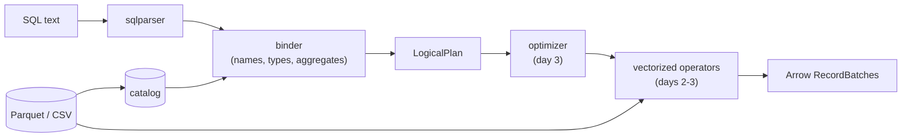

# Quarry

A SQL query engine over Parquet and CSV files, written in Rust on Apache Arrow (arrow-rs). It takes a SQL string,
resolves every name and type against the files' schemas, builds a logical plan, and (from day 2) executes it with
vectorized operators over Arrow record batches.

**Status: day 1 of 5.** The readers, the catalog, the logical plan and the binder (SQL to a typed plan) are done
and tested; nothing executes yet. Day 2 adds execution of projection, filter, aggregate, sort and limit; day 3
hash joins, predicate pushdown and optimizer rules; day 4 TPC-H-style queries checked against DuckDB, and
benchmarks; day 5 a REPL and the release.

## Why

The interesting part of a database is the middle: how `SELECT customer, sum(total) ... GROUP BY customer HAVING
count(*) > 1 ORDER BY 2` becomes a tree of operators that means exactly what the SQL says. Quarry builds that middle
by hand (binder, plan, optimizer, operators) and borrows the two ends that aren't the point: `sqlparser` for the
grammar and Arrow for the columnar memory format and its compute kernels.

## Architecture



- **Readers** (`crates/quarry/src/datasource/`): a `TableProvider` trait (schema, scan with a projection and batch
  size, statistics) with three tables. `ParquetTable` reads the footer once and decodes only projected columns;
  `CsvTable` infers a schema from the first 1,000 rows; `MemTable` holds batches for tests.
- **Catalog** (`catalog.rs`): table names, matched without regard to case.
- **Logical plan** (`plan/`): Scan, Empty, Filter, Projection, Aggregate, Join, Sort, Limit. Expressions are
  *bound*: a column is an index into the node's input, and every coercion is an explicit `Cast`.
- **Binder** (`sql/`): one SELECT, clause by clause in SQL's logical order (FROM, WHERE, GROUP BY and aggregates,
  HAVING, the select list, DISTINCT, ORDER BY, LIMIT). Every mistake a query can contain is reported here, before
  any data is read.

DESIGN.md is the specification: the type rules, name resolution, each node, and the eight binding steps.

## Layout

```
crates/quarry/          the engine (a library)
  src/datasource/       TableProvider; Parquet, CSV and in-memory tables
  src/catalog.rs        table names to tables
  src/types.rs          type classes, the common-type rules, strict dates
  src/plan/             LogicalPlan, bound Expr, printing
  src/sql/              parsing and the binder
  tests/                datasource.rs, binder.rs, binder_properties.rs
crates/quarry-cli/      the `quarry` binary and its tests
examples/orders.csv     eight synthetic rows for the examples below
DESIGN.md               the specification
```

## Try it

```bash
cargo build --release
```

```bash
./target/release/quarry schema examples/orders.csv
```

```
order_id: Int64
customer: Utf8
status: Utf8
total: Float64
placed: Date32
```

`quarry plan` binds a query against files and prints the plan (`-t PATH` names the table after the file, or `-t
NAME=PATH`):

```bash
./target/release/quarry plan -t examples/orders.csv "SELECT customer, count(*) AS orders, sum(total) AS spent FROM orders WHERE status <> 'cancelled' AND placed >= '2024-01-01' GROUP BY customer HAVING count(*) > 1 ORDER BY spent DESC LIMIT 3"
```

```
Limit: skip=0 fetch=3
  Sort: spent DESC NULLS LAST
    Projection: orders.customer, count(*) AS orders, sum(orders.total) AS spent
      Filter: count(*) > 1
        Aggregate: group_by=[orders.customer] aggregates=[count(*), sum(orders.total)]
          Filter: orders.status <> 'cancelled' AND orders.placed >= DATE '2024-01-01'
            Scan: orders
```

The string `'2024-01-01'` became a `DATE` because it is compared with a date column; `count(*)` in `HAVING` is the
same aggregate as in the select list, so the Aggregate computes it once. A query that doesn't make sense fails
before anything is read, with status 1:

```bash
./target/release/quarry plan -t examples/orders.csv "SELECT customer FROM orders WHERE total > 'big'"
```

```
error: plan error: cannot compare Float64 with Utf8 ('big') in total > 'big'
```

`quarry head -n 3 examples/orders.csv` prints rows; `quarry --help` lists the rest.

## Tests

`make check` runs rustfmt, Clippy with warnings as errors, every test, and the docs with no broken links; CI runs
it on Linux (ubuntu-24.04) and macOS (macos-15) on every push.

| Suite | What it checks |
|---|---|
| `tests/datasource.rs` (17) | Parquet and CSV files written in the test read back equal; projections in any order and with repeats; empty projections still count rows; batch sizes; inferred CSV types and NULLs; the catalog's names |
| `tests/binder.rs` (29) | each binding rule in DESIGN.md: the printed plan, or the error and its message |
| `tests/binder_properties.rs` (3) | random expressions against a model of the type rules (below) |
| unit tests (11) | the common-type rules, date parsing over every day from 1600 to 2400 and against Arrow's own cast, expression printing |
| `quarry-cli/tests/cli.rs` (6) | the built binary: output, exit codes, errors on stderr, and that this README's examples print what it says |

The property tests bind `SELECT <expr> FROM t` for expressions from two generators (a random grammar of every
supported operator, mostly ill-typed, and a type-directed one that builds well-typed trees three operators deep)
and compare each with a model in the test that re-reads DESIGN.md's rules without sharing code with the binder. An
expression the model types must bind to exactly that type and nullability; one it refuses must fail with an error;
nothing may panic; and every bound operator must see one type on both sides. Mutating the binder (dropping its
casts, integer division, a wrong nullability) fails them; see the commit that added them for the run.

## Design decisions

- **Borrow the parser, write the binder.** SQL's grammar is large and `sqlparser` handles it well. The binder is
  where a query's meaning is decided (which `a`, which type, which aggregate) and is written here.
- **Bound expressions carry column indices, not names.** Names are resolved once, in the binder; after that a plan
  never looks a name up, so `SELECT a.id, b.id` can't be confused, and the optimizer's rewrites (day 3) work on
  indices.
- **Casts are explicit in the plan.** The binder decides every coercion and writes it down as a `Cast`, so the
  executor never meets two types on one operator, and the printed plan shows exactly what will be computed.
- **DuckDB's semantics where SQL dialects differ**, because day 4 uses DuckDB as the oracle: names match without
  regard to case, `/` is always float division, NULLs sort last in both directions, an all-empty CSV column is a
  string column.
- **PostgreSQL's rules for ORDER BY and GROUP BY names**: an output name counts only as a bare name (`ORDER BY x +
  1` doesn't see the alias `x`), and in GROUP BY a FROM column wins over an alias of the same name.
- **Errors, never panics, on any query or file.** `QuarryError` says whose fault it is: the query's (`Sql`,
  `Plan`), the engine's (`Unsupported`, naming what), or the data's (`Table`, `Io`, `Arrow`, `Parquet`).

## Limitations (day 1)

- Nothing executes yet: `quarry plan` prints a plan, nothing runs one.
- No subqueries, `WITH`, `UNION`, window functions, `RIGHT`/`FULL` joins, intervals, or scalar functions other
  than `CAST`; each is a clear `Unsupported` error.
- No decimal, timestamp or `UInt64` arithmetic: such columns can be selected but not computed on.
- CSV schemas are inferred from the first 1,000 rows by default; a later value of another type fails the scan that
  reaches it (`CsvOptions { infer_rows: None, .. }` reads the whole file to infer).
- Integer literals must fit in 64 bits.

## License

MIT.
