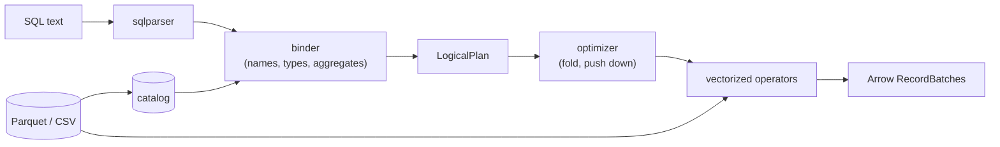

# Quarry

A SQL query engine over Parquet and CSV files, written in Rust on Apache Arrow (arrow-rs). It takes a SQL string,
resolves every name and type against the files' schemas, builds a logical plan, and executes it with vectorized
operators over Arrow record batches.

**Status: day 3 of 5.** The readers, the catalog, the logical plan, the binder (SQL to a typed plan), the executor
(filter, projection, aggregate with GROUP BY and DISTINCT, sort and top-k, limit, hash and nested-loop joins, and
vectorized expressions) and the optimizer (constant folding, predicate pushdown through joins and into Parquet row
groups, projection pushdown) are done and tested; `quarry query` runs a query over files. Day 4 adds TPC-H-style
queries checked against DuckDB, and benchmarks; day 5 a REPL and the release.

## Why

The interesting part of a database is the middle: how `SELECT customer, sum(total) ... GROUP BY customer HAVING
count(*) > 1 ORDER BY 2` becomes a tree of operators that means exactly what the SQL says. Quarry builds that middle
by hand (binder, plan, optimizer, operators) and borrows the two ends that aren't the point: `sqlparser` for the
grammar and Arrow for the columnar memory format and its compute kernels.

## Architecture



- **Readers** (`crates/quarry/src/datasource/`): a `TableProvider` trait (schema, scan with a projection and batch
  size, statistics) with three tables. `ParquetTable` reads the footer once and decodes only projected columns;
  `CsvTable` infers a schema from the first 1,000 rows; `MemTable` holds batches for tests.
- **Catalog** (`catalog.rs`): table names, matched without regard to case.
- **Logical plan** (`plan/`): Scan, Empty, Filter, Projection, Aggregate, Join, Sort, Limit. Expressions are
  *bound*: a column is an index into the node's input, and every coercion is an explicit `Cast`.
- **Binder** (`sql/`): one SELECT, clause by clause in SQL's logical order (FROM, WHERE, GROUP BY and aggregates,
  HAVING, the select list, DISTINCT, ORDER BY, LIMIT). Every mistake a query can contain is reported here, before
  any data is read.
- **Executor** (`exec/mod.rs`): each plan node is an iterator of record batches pulling from its input's. Filter,
  projection and limit stream (a LIMIT stops reading once it has its rows); sort and aggregate drain their input.
  Every result batch is checked against the plan's types and nullability.
- **Expressions** (`exec/expr.rs`): a column at a time with Arrow's kernels, literals kept as scalars; `AND`, `OR`
  and `CASE` evaluate later operands only on the rows still undecided, so `b <> 0 AND a % b = 1` never divides by
  zero. Overflow, `% 0` and failed casts are errors, as in DuckDB 2.0.
- **Aggregation** (`exec/aggregate.rs`): group keys encoded in Arrow's row format and hashed; one accumulator per
  aggregate (integer sums in i128); `DISTINCT` by remembering (group, value) pairs.
- **Joins** (`exec/join.rs`, day 3): a hash join on `ON`'s equalities (the right input built into a table keyed by
  Arrow's row format, floats normalized, NULL keys matching nothing; the left streaming through it), a nested loop
  when there are none; the rest of `ON` is computed only on candidate pairs. Output in the left input's order at any
  batch size, a LEFT join's unmatched rows in place.
- **Optimizer** (`optimizer/`, day 3): constant folding that leaves failing constants to fail lazily; predicate
  pushdown that moves conditions below joins to the side they read (a comma join with an equality becomes a hash
  join) and hands them to Parquet scans; projection pushdown that narrows each scan to the columns used above it.
- **Row-group pruning** (`datasource/pruning.rs`, day 3): a scan's filters rewritten into conditions on each row
  group's min, max and null count, evaluated by the engine's own evaluator; a group is skipped only where that is
  FALSE, and the filter still checks every row read.
- **Top-k** (`exec/mod.rs`, day 3): `ORDER BY ... LIMIT k` keeps the best `k` rows by partial sorts of `2k`, never
  sorting the whole input.

DESIGN.md is the specification: the type rules, name resolution, each node, the eight binding steps, and execution
(each rule where engines differ, checked on DuckDB 2.0).

## Layout

```
crates/quarry/          the engine (a library)
  src/datasource/       TableProvider; Parquet, CSV and in-memory tables; row-group pruning (pruning.rs)
  src/catalog.rs        table names to tables
  src/types.rs          type classes, the common-type rules, strict dates
  src/plan/             LogicalPlan, bound Expr, printing
  src/sql/              parsing and the binder
  src/exec/             the executor: operators and top-k (mod.rs), expressions (expr.rs), aggregation
                        (aggregate.rs), joins (join.rs)
  src/optimizer/        the rules: constant folding (fold.rs), predicate pushdown (predicates.rs), projection
                        pushdown (columns.rs)
  tests/                datasource.rs, binder.rs, binder_properties.rs, execute.rs, eval_properties.rs,
                        query_properties.rs, join_properties.rs, optimizer.rs, pruning.rs
  examples/             gen_orders.rs (synthetic Parquet data), time_queries.rs (the timings below)
scripts/duckdb_times.py the same timings in DuckDB, for scale
crates/quarry-cli/      the `quarry` binary and its tests
examples/orders.csv     eight synthetic rows for the examples below
DESIGN.md               the specification
```

## Try it

```bash
cargo build --release
```

```bash
./target/release/quarry schema examples/orders.csv
```

```
order_id: Int64
customer: Utf8
status: Utf8
total: Float64
placed: Date32
```

`quarry plan` binds a query against files and prints the plan (`-t PATH` names the table after the file, or `-t
NAME=PATH`):

```bash
./target/release/quarry plan -t examples/orders.csv "SELECT customer, count(*) AS orders, sum(total) AS spent FROM orders WHERE status <> 'cancelled' AND placed >= '2024-01-01' GROUP BY customer HAVING count(*) > 1 ORDER BY spent DESC LIMIT 3"
```

```
Limit: skip=0 fetch=3
  Sort: spent DESC NULLS LAST
    Projection: orders.customer, count(*) AS orders, sum(orders.total) AS spent
      Filter: count(*) > 1
        Aggregate: group_by=[orders.customer] aggregates=[count(*), sum(orders.total)]
          Filter: orders.status <> 'cancelled' AND orders.placed >= DATE '2024-01-01'
            Scan: orders
```

The string `'2024-01-01'` became a `DATE` because it is compared with a date column; `count(*)` in `HAVING` is the
same aggregate as in the select list, so the Aggregate computes it once. `quarry query` runs it:

```bash
./target/release/quarry query -t examples/orders.csv "SELECT customer, count(*) AS orders, sum(total) AS spent FROM orders WHERE status <> 'cancelled' AND placed >= '2024-01-01' GROUP BY customer HAVING count(*) > 1 ORDER BY spent DESC LIMIT 3"
```

```
+----------+--------+--------+
| customer | orders | spent  |
+----------+--------+--------+
| bo       | 2      | 275.0  |
| ada      | 3      | 202.85 |
+----------+--------+--------+
2 rows
```

A query that doesn't make sense fails before anything is read, with status 1:

```bash
./target/release/quarry plan -t examples/orders.csv "SELECT customer FROM orders WHERE total > 'big'"
```

```
error: plan error: cannot compare Float64 with Utf8 ('big') in total > 'big'
```

`quarry head -n 3 examples/orders.csv` prints rows; `quarry --help` lists the rest.

## Tests

`make check` runs rustfmt, Clippy with warnings as errors, every test, and the docs with no broken links; CI runs
it on Linux (ubuntu-24.04) and macOS (macos-15) on every push.

| Suite | What it checks |
|---|---|
| `tests/datasource.rs` (22) | Parquet and CSV files written in the test read back equal; projections in any order and with repeats; empty projections still count rows; batch sizes (0 included); inferred CSV types, NULLs, timestamps and impossible dates; the catalog's names |
| `tests/binder.rs` (41) | each binding rule in DESIGN.md: the printed plan, or the error and its message; the review's findings; the depth limit on a 2 MiB stack |
| `tests/binder_properties.rs` (3) | random expressions against a model of the type rules (below) |
| `tests/execute.rs` (26) | queries end to end at batch sizes 1, 2, 3 and 8192, each run as bound and as optimized (all eight runs must agree, rows or error): filters, projections, ORDER BY (NULLs, -0.0, ties, hidden keys), LIMIT/OFFSET, that a LIMIT stops reading and computes only its rows, every aggregate, GROUP BY expressions, HAVING, DISTINCT, aggregates over no rows, float groups, i128 sums, errors; inner, LEFT and cross joins (order, NULL and float keys, casts, residuals, empty sides, three tables); the same queries over CSV and Parquet files |
| `tests/eval_properties.rs` (3) | random well-typed expressions over random rows, evaluated by the engine and by a row-at-a-time reference interpreter in the test (below) |
| `tests/query_properties.rs` (3) | random GROUP BY queries, and random ORDER BY with LIMIT and OFFSET, at random batch sizes against a reference grouping and a stable sort in plain Rust |
| `tests/join_properties.rs` (1) | random INNER and LEFT joins of two random tables on random `ON`s (key equalities, comparisons, one-sided conditions, constants) at batch sizes 1-7, row for row against a nested loop in plain Rust with SQL's three-valued `AND` |
| `tests/optimizer.rs` (4) | what each rule does to the printed plan: scans narrowed (`count(*)` reads no column), constants folded and failing ones kept, AND/OR simplified, conditions moved below inner and LEFT joins |
| `tests/pruning.rs` (4) | random rows in Parquet row groups of 1-4 rows under random filters give the same rows pruned and unpruned; which row groups an ordered file skips, floats included; EXPLAIN's scan filters |
| unit tests (30) | the common-type rules, date parsing over every day from 1600 to 2400 and against Arrow's own cast, expression printing, the plan nodes' guards and schemas; each operator of the evaluator, with DuckDB 2.0's answers; constant folding |
| `quarry-cli/tests/cli.rs` (9) | the built binary: output, exit codes, errors on stderr, `quarry query`, and that this README's examples print what it says |

The property tests bind `SELECT <expr> FROM t` for expressions from two generators (a random grammar of every
supported operator, mostly ill-typed, and a type-directed one that builds well-typed trees three operators deep)
and compare each with a model in the test that re-reads DESIGN.md's rules without sharing code with the binder. An
expression the model types must bind to exactly that type and nullability; one it refuses must fail with an error;
nothing may panic; every bound operator must see one type on both sides; and the printed expression must bind back
to the same tree. Mutating the binder (dropping its casts, integer division, a wrong nullability, LIKE's printing
precedence) fails them. `PROPTEST_CASES=100000 cargo test --release -p quarry --test binder_properties` searches
longer (about 5 s here); CI's Linux job runs that on every push.

The evaluator's property test generates well-typed SQL expressions (every operator, `CASE`, `IN`, `LIKE`, casts,
date arithmetic) over random rows full of edge values (i64::MIN and MAX, -0.0, NaN, infinity, f32::MAX in a REAL
column, backslashes, newlines) and evaluates each with the engine and with an interpreter in the test that applies DESIGN.md's rules one row at a
time over plain Rust values. The two must agree on every value, floats bit for bit, or both fail, and two slices of
the batch must give the same as the whole. The GROUP BY property does the same for random queries (no key, or one or
two of four columns; one to four aggregates, each maybe DISTINCT) against a grouping in plain Rust. Twelve mutations
of the engine (six in the evaluator, six in aggregation) each fail one of them. CI runs both at 100,000 cases.

## Results (day 2)

Seven queries over 10,000,000 synthetic orders in one Parquet file (75 MB, zstd, 10 row groups), each run in process
once to warm up and then five times; the median, at commit `5d4ef95`. Apple M3, macOS 26.6.2, Rust 1.99.0 release
build, on battery (Low Power Mode off), 2026-10-27; no run had the machine asleep. One thread.

```bash
cargo run --release -p quarry --example gen_orders -- 10000000 data/orders_10m.parquet
cargo run --release -p quarry --example time_queries -- data/orders_10m.parquet 5
```

| Query | Quarry | Rows/s | DuckDB 2.0, 1 thread | DuckDB, 8 threads |
|---|---|---|---|---|
| `count(*)` | 217.5 ms | 46 M | 0.2 ms | 0.3 ms |
| filter (`status = 'shipped' AND total > 500`) + count | 508.9 ms | 20 M | 84.8 ms | 22.1 ms |
| GROUP BY status (3 groups): count, sum, avg | 481.4 ms | 21 M | 97.5 ms | 24.6 ms |
| filter, GROUP BY customer (10,000 groups), top 5 | 314.5 ms | 32 M | 86.5 ms | 24.1 ms |
| filter, `sum(total * qty)`, `avg(qty * 2 + 1)` | 263.1 ms | 38 M | 85.3 ms | 23.1 ms |
| `count(DISTINCT customer)` | 682.3 ms | 15 M | 17.9 ms | 5.9 ms |
| ORDER BY total DESC, order_id LIMIT 10 | 2,051.9 ms | 5 M | 135.7 ms | 33.4 ms |

The DuckDB columns are the same queries on the same file through its Python API (`python
scripts/duckdb_times.py data/orders_10m.parquet`, median of five after a warm-up), for scale, not as a race: both gave the same answers (the sums differ in the last
digits, from adding in another order). What the numbers say about day 3: every scan decodes all six columns, because
nothing tells it which are needed (projection pushdown), so even `count(*)` reads the whole file, where DuckDB reads
the row count from the footer; a filter copies all six columns of the rows it keeps; and `ORDER BY ... LIMIT 10`
sorts all 10 million rows and gathers every column for them, where a top-k needs ten.

## Review of day 2

One review agent read the executor at `b28260b` (23 minutes, in its own worktree, DuckDB 2.0 at hand as an oracle):
about 230 queries over Parquet and CSV files DuckDB had written, each at batch sizes 1, 2, 3 and 8192, diffed against
DuckDB's answers, plus in-memory edge cases (NULL-typed columns, Utf8View, empty batches). It reproduced three bugs,
each now fixed with its test in the suites:

| Finding | Fix |
|---|---|
| `CAST(1e300 AS REAL)` gave `inf`: Arrow's float-to-float cast has no range check | a finite Float64 that rounds to an infinite Float32 fails its cast, as in DuckDB (`a624684`; the first version also failed values just above f32::MAX that round down to it, found by the second review, `3270519`) |
| -0.0 came back as 0.0 from MIN, MAX, GROUP BY keys and DISTINCT (`1 / min(f)` was `inf`, DuckDB `-inf`): the normalized bytes used to compare were decoded into the result | outputs are input values: a group's first key, the winning MIN/MAX value (`5d4ef95`) |
| `SELECT 10 % (id - 3) FROM t LIMIT 2` failed at batch sizes 3 and up but not 1 or 2: the projection computed whole batches before the LIMIT sliced them | a LIMIT runs below projections (`b9776c4`) |

Of its 30 mutations of `exec/`, seven left every test passing at its commit (one equivalent); four of those fail the
property tests written since, and the other three got tests (`066093a`, `52b3f08`). Its judgement calls are in the
limitations below.

A second agent then reviewed the three fixes (8 minutes, at `dda4d6f`). It found a bug in one: the Float32 range check
ran before rounding, so `CAST(3.4028235e38 AS REAL)` (f32::MAX as Quarry prints it) failed where DuckDB rounds to
f32::MAX; the check now looks at the result (`3270519`). And it corrected a claim in the LIMIT fix: DuckDB computes
some select items after its top-N (`SELECT CAST(s AS INT) FROM t ORDER BY id LIMIT 2` succeeds there and fails here),
now a limitation for day 3. Of its 10 mutations of the fixes, 3 survived: an exact-f32::MAX boundary and a NULL over a
huge value (both tested now), and DISTINCT passing normalized values on, which no aggregate today can show.

## Review of day 1

One review agent read the day's code at `6a48287` against DESIGN.md (19 minutes, in its own worktree) and saved
each bug it reproduced as a failing test. It found 10; each is fixed, and its test, adapted, is in the suites above:

| Finding | Fix |
|---|---|
| `GROUP BY a` with `a` an ambiguous FROM column fell back to a select alias | the alias is only for names no FROM column has |
| `SELECT DISTINCT FROM t` and `SELECT FROM t HAVING TRUE` bound to the same plan, which need 0 and 1 rows | an empty select list is an error |
| `avg(DISTINCT a)` deduplicated `CAST(a AS Float64)`: 2^53 and 2^53 + 1 counted once | AVG's argument widens as SUM's does; the division is last |
| a 5,000-term `OR` chain overflowed the stack and aborted the process | expressions nest at most 128 deep (`MAX_EXPR_DEPTH`) |
| `-x` on a Float32 came out Float64 | floats keep their type |
| `(s LIKE 'a') = flag` printed as `s LIKE 'a' = flag`, which parses differently | printing follows sqlparser's precedence |
| a column named `x + 1` printed like the expression `x + 1` | a table column's name is quoted when it isn't an identifier |
| `AS "from"` printed as `AS from` | reserved words are quoted |
| CSV date-times inferred as `Timestamp`, which no expression takes | read as strings |
| one `2024-02-30` in a CSV's sampled rows made the file unreadable | a date column with an impossible date is strings |

Of its 31 mutations, 25 left every test passing at its commit. Re-run against the suite after the property tests,
12 still did; each now has a test, and all fail the suite (`git log` on `1ec4696` lists them). The round-trip
property then found one more bug itself: `-(-0)` printed as `-0`, which binds back as the literal 0, not a negation
(`0d191f7`).

## Design decisions

- **Borrow the parser, write the binder.** SQL's grammar is large and `sqlparser` handles it well. The binder is
  where a query's meaning is decided (which `a`, which type, which aggregate) and is written here.
- **Bound expressions carry column indices, not names.** Names are resolved once, in the binder; after that a plan
  never looks a name up, so `SELECT a.id, b.id` can't be confused, and the optimizer's rewrites (day 3) work on
  indices.
- **Casts are explicit in the plan.** The binder decides every coercion and writes it down as a `Cast`, so the
  executor never meets two types on one operator, and the printed plan shows exactly what will be computed.
- **DuckDB's semantics where SQL dialects differ**, because day 4 uses DuckDB as the oracle: names match without
  regard to case, `/` is always float division, NULLs sort last in both directions, an all-empty CSV column is a
  string column.
- **PostgreSQL's rules for ORDER BY and GROUP BY names**: an output name counts only as a bare name (`ORDER BY x +
  1` doesn't see the alias `x`), and in GROUP BY a FROM column wins over an alias of the same name.
- **Errors, never panics, on any query or file.** `QuarryError` says whose fault it is: the query's (`Sql`,
  `Plan`), the engine's (`Unsupported`, naming what), or the data's (`Execution`, `Table`, `Io`, `Arrow`,
  `Parquet`).
- **Batches, pulled.** Operators are iterators of Arrow record batches (8,192 rows by default): an expression is
  dispatched once per batch and runs as a tight loop inside Arrow's kernels, and a consumer that stops pulling (a
  LIMIT) stops the work below it.
- **Lazy AND, OR and CASE**, as in DuckDB: guards such as `b <> 0 AND a % b = 1` work, at the cost of taking the
  undecided rows out of the batch and putting the results back.
- **Errors over NULLs.** Overflow, `% 0` and a failed cast stop the query (DuckDB's behaviour), so no answer is
  silently missing values; it also keeps the plan's nullability honest.
- **Group by bytes.** Arrow's row format turns any combination of key columns into one comparable, hashable byte
  string, so grouping, DISTINCT and MIN/MAX each have one implementation for every type, not one per type.
- **Join keys by the same bytes**, with one row converter for both sides, so a join's equality is GROUP BY's: -0.0
  meets 0.0, NaN meets NaN, NULL meets nothing.
- **A defined join order.** The output follows the left input, each row's matches in build order, a LEFT join's
  unmatched rows in place, at every batch size; it costs a little bookkeeping (`done_rows`) and lets every join test
  compare rows in order.
- **Optimizer rules that keep the schema**, checked by running every test query with and without them: a rule that
  changes rows fails a hundred existing tests, not one new one.
- **Pruning as a hint, evaluated by the engine.** Scans get the filters but the filter node stays, and the statistics
  conditions run through the same evaluator as the query, so pruning can only be too cautious, never differently
  typed or ordered than the filter; random data checks it can't drop a row.

## Limitations (day 3)

- Sort and aggregate hold their whole input or all groups in memory, and a join its whole right input; there is no
  spilling to disk, and one thread does all the work. The right input is always the build side (no join reordering,
  no choice of the smaller side), and `RIGHT`/`FULL` joins aren't supported.
- Predicate pushdown moves a condition onto rows its original place wouldn't have computed it for, so a condition
  that fails on some row can fail where the unoptimized plan didn't (DESIGN.md, "The optimizer"); DuckDB 2.0 does
  the same. Conjuncts are computed in their written order: `WHERE 1 % 0 = 0 AND id > 100` fails here, where DuckDB
  reorders it and returns no rows.
- Row-group pruning uses the footer's per-row-group min, max and null counts only (no page index, no Bloom filters,
  nothing for CSV), and trusts them: a file whose writer recorded wrong statistics can give wrong answers. For float
  columns only `<`, `<=` and `=` with a number prune.
- Projection pushdown narrows scans only: a projection item nothing uses is still computed. Conditions don't move
  through aggregates (a HAVING on a group key) or projections.
- Where Arrow's kernels and DuckDB differ in details not covered by DESIGN.md's table, Quarry follows Arrow: string to
  number casts don't trim spaces (`CAST(' 12' AS INT)` fails; DuckDB gives 12), floats print as Arrow prints them.
- `SUM` of integers is an Int64 and fails past it (DuckDB returns a 128-bit integer); dates end at Date32's range,
  and a date past about ±262,000 years computes but can't be printed.
- A number with a point is a Float64, where DuckDB makes it a DECIMAL: `CAST(2.5 AS SMALLINT)` is 2 here (half to
  even) and 3 in DuckDB, and `9223372036854775807.0` doesn't cast back to BIGINT. Small integers widen to Int64 for
  arithmetic, so `tinyint_col + tinyint_col` can't overflow where DuckDB's TINYINT would.
- The binder allows any cast Arrow can do (`CAST(d AS INT)`, `CAST(7 AS DATE)`), several of which DuckDB refuses,
  and `%` takes integers only (DuckDB computes `5.5 % 2`).
- An error in a WHERE under a LIMIT can depend on the batch size (DESIGN.md, "Execution"); DuckDB's can too. Under
  `ORDER BY ... LIMIT`, every select item is computed for every row before the top-k, where DuckDB computes some
  after its top-N.
- No subqueries, `WITH`, `UNION`, window functions, intervals, or scalar functions other than `CAST`; each is a clear
  `Unsupported` error.
- No decimal, timestamp or `UInt64` arithmetic: such columns can be selected but not computed on.
- CSV schemas are inferred from the first 1,000 rows by default; a later value of another type fails the scan that
  reaches it (`CsvOptions { infer_rows: None, .. }` reads the whole file to infer).
- Integer literals must fit in 64 bits, and expressions nest at most 128 levels (a chain of 128 `OR`s).

## License

MIT.
