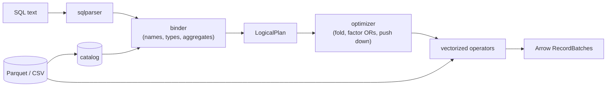

# Quarry

A SQL query engine over Parquet and CSV files, written in Rust on Apache Arrow (arrow-rs). It takes a SQL string,
resolves every name and type against the files' schemas, builds a logical plan, and executes it with vectorized
operators over Arrow record batches.

**Status: v1.0.0.** Built in five days: the readers, the catalog, the logical plan and the binder (SQL to a typed
plan) on day 1; the executor (filter, projection, aggregate with GROUP BY and DISTINCT, sort, limit, vectorized
expressions) on day 2; hash and nested-loop joins, the top-k, the optimizer (constant folding, predicate pushdown
through joins and into Parquet row groups, projection pushdown) on day 3; a TPC-H-style data generator, eight TPC-H
queries checked against DuckDB's answers, `OR` factoring, a differential test of random queries against DuckDB (in
CI), criterion benchmarks and timings on day 4; and `quarry repl`, an interactive shell, on day 5. `quarry query`
runs one query over files; `quarry repl` runs many.

## Why

The interesting part of a database is the middle: how `SELECT customer, sum(total) ... GROUP BY customer HAVING
count(*) > 1 ORDER BY 2` becomes a tree of operators that means exactly what the SQL says. Quarry builds that middle
by hand (binder, plan, optimizer, operators) and borrows the two ends that aren't the point: `sqlparser` for the
grammar and Arrow for the columnar memory format and its compute kernels.

## Architecture



- **Readers** (`crates/quarry/src/datasource/`): a `TableProvider` trait (schema, scan with a projection and batch
  size, statistics) with three tables. `ParquetTable` reads the footer once and decodes only projected columns;
  `CsvTable` infers a schema from the first 1,000 rows; `MemTable` holds batches for tests.
- **Catalog** (`catalog.rs`): table names, matched without regard to case.
- **Logical plan** (`plan/`): Scan, Empty, Filter, Projection, Aggregate, Join, Sort, Limit. Expressions are
  *bound*: a column is an index into the node's input, and every coercion is an explicit `Cast`.
- **Binder** (`sql/`): one SELECT, clause by clause in SQL's logical order (FROM, WHERE, GROUP BY and aggregates,
  HAVING, the select list, DISTINCT, ORDER BY, LIMIT). Every mistake a query can contain is reported here, before
  any data is read.
- **Executor** (`exec/mod.rs`): each plan node is an iterator of record batches pulling from its input's. Filter,
  projection and limit stream (a LIMIT stops reading once it has its rows); sort and aggregate drain their input.
  Every result batch is checked against the plan's types and nullability.
- **Expressions** (`exec/expr.rs`): a column at a time with Arrow's kernels, literals kept as scalars; `AND`, `OR`
  and `CASE` evaluate later operands only on the rows still undecided, so `b <> 0 AND a % b = 1` never divides by
  zero. Overflow, `% 0` and failed casts are errors, as in DuckDB 2.0.
- **Aggregation** (`exec/aggregate.rs`): group keys encoded in Arrow's row format and hashed; one accumulator per
  aggregate (integer sums in i128); `DISTINCT` by remembering (group, value) pairs.
- **Joins** (`exec/join.rs`, day 3): a hash join on `ON`'s equalities (the right input built into a table keyed by
  Arrow's row format, floats normalized, NULL keys matching nothing; the left streaming through it), a nested loop
  when there are none; the rest of `ON` is computed only on candidate pairs. Output in the left input's order at any
  batch size, a LEFT join's unmatched rows in place.
- **Optimizer** (`optimizer/`, day 3): constant folding that leaves failing constants to fail lazily; `OR` factoring
  (day 4) that moves conjuncts every branch shares out of the `OR`, so TPC-H Q19's join key becomes one; predicate
  pushdown that moves conditions below joins to the side they read (a comma join with an equality becomes a hash
  join) and hands them to Parquet scans; projection pushdown that narrows each scan to the columns used above it.
- **Row-group pruning** (`datasource/pruning.rs`, day 3): a scan's filters rewritten into conditions on each row
  group's min, max and null count, evaluated by the engine's own evaluator; a group is skipped only where that is
  FALSE, and the filter still checks every row read.
- **Top-k** (`exec/mod.rs`, day 3): `ORDER BY ... LIMIT k` keeps the best `k` rows by partial sorts of
  `max(2k, k + batch_size)` rows, never sorting the whole input.

- **TPC-H-style data** (`crates/quarry-tpch`, day 4): seven TPC-H tables at any scale factor, deterministic, with
  TPC-H's value rules (simplified where the queries don't care: `DOUBLE` money, dense keys); eight TPC-H queries and
  DuckDB's answers to them. `scripts/differential.py` runs random queries through Quarry's CLI and DuckDB and
  compares the rows.

DESIGN.md is the specification: the type rules, name resolution, each node, the eight binding steps, and execution
(each rule where engines differ, checked on DuckDB 2.0).

## Layout

```
crates/quarry/          the engine (a library)
  src/datasource/       TableProvider; Parquet, CSV and in-memory tables; row-group pruning (pruning.rs)
  src/catalog.rs        table names to tables
  src/types.rs          type classes, the common-type rules, strict dates
  src/plan/             LogicalPlan, bound Expr, printing
  src/sql/              parsing, the binder, and the REPL's statement splitter (split.rs)
  src/exec/             the executor: operators and top-k (mod.rs), expressions (expr.rs), aggregation
                        (aggregate.rs), joins (join.rs)
  src/optimizer/        the rules: constant folding (fold.rs), OR factoring (factor.rs), predicate pushdown
                        (predicates.rs), projection pushdown (columns.rs)
  tests/                datasource.rs, binder.rs, binder_properties.rs, execute.rs, eval_properties.rs,
                        query_properties.rs, join_properties.rs, optimizer.rs, optimizer_properties.rs,
                        pruning.rs, skipped_errors.rs, tpch.rs (TPC-H answers vs DuckDB's),
                        split_properties.rs (the splitter vs the tokenizer)
  benches/tpch.rs       criterion benchmarks of the TPC-H queries
  examples/             gen_orders.rs (synthetic Parquet data), time_queries.rs and tpch_times.rs (the timings
                        below)
crates/quarry-tpch/     TPC-H-style tables (src/lib.rs), the `tpch-gen` binary, the queries (queries/), DuckDB's
                        answers at scale 0.01 (answers/), the generator's tests
crates/quarry-cli/      the `quarry` binary: subcommands (src/main.rs), the REPL (src/repl.rs), tests
scripts/                differential.py (random queries vs DuckDB), tpch_answers.py (writes answers/),
                        tpch_duckdb_times.py and duckdb_times.py (DuckDB's timings, for scale)
examples/orders.csv     eight synthetic rows for the examples below
examples/customers.csv  four synthetic customers, for the join example
examples/session.sql    a script for the REPL example
DESIGN.md               the specification
```

## Try it

```bash
cargo build --release
```

```bash
./target/release/quarry schema examples/orders.csv
```

```
order_id: Int64
customer: Utf8
status: Utf8
total: Float64
placed: Date32
```

`quarry plan` binds a query against files and prints the plan (`-t PATH` names the table after the file, or `-t
NAME=PATH`):

```bash
./target/release/quarry plan -t examples/orders.csv "SELECT customer, count(*) AS orders, sum(total) AS spent FROM orders WHERE status <> 'cancelled' AND placed >= '2024-01-01' GROUP BY customer HAVING count(*) > 1 ORDER BY spent DESC LIMIT 3"
```

```
Limit: skip=0 fetch=3
  Sort: spent DESC NULLS LAST
    Projection: orders.customer, count(*) AS orders, sum(orders.total) AS spent
      Filter: count(*) > 1
        Aggregate: group_by=[orders.customer] aggregates=[count(*), sum(orders.total)]
          Filter: orders.status <> 'cancelled' AND orders.placed >= DATE '2024-01-01'
            Scan: orders
```

The string `'2024-01-01'` became a `DATE` because it is compared with a date column; `count(*)` in `HAVING` is the
same aggregate as in the select list, so the Aggregate computes it once. `quarry query` runs it:

```bash
./target/release/quarry query -t examples/orders.csv "SELECT customer, count(*) AS orders, sum(total) AS spent FROM orders WHERE status <> 'cancelled' AND placed >= '2024-01-01' GROUP BY customer HAVING count(*) > 1 ORDER BY spent DESC LIMIT 3"
```

```
+----------+--------+--------+
| customer | orders | spent  |
+----------+--------+--------+
| bo       | 2      | 275.0  |
| ada      | 3      | 202.85 |
+----------+--------+--------+
2 rows
```

`EXPLAIN` in `quarry query` prints the plan that runs: optimized (the scan reads four of the five columns) and with
each node's operator (the sort under the LIMIT is a top-k of three rows):

```bash
./target/release/quarry query -t examples/orders.csv "EXPLAIN SELECT customer, count(*) AS orders, sum(total) AS spent FROM orders WHERE status <> 'cancelled' AND placed >= '2024-01-01' GROUP BY customer HAVING count(*) > 1 ORDER BY spent DESC LIMIT 3"
```

```
Limit: skip=0 fetch=3
  TopK: k=3 spent DESC NULLS LAST
    Projection: orders.customer, count(*) AS orders, sum(orders.total) AS spent
      Filter: count(*) > 1
        Aggregate: group_by=[orders.customer] aggregates=[count(*), sum(orders.total)]
          Filter: orders.status <> 'cancelled' AND orders.placed >= DATE '2024-01-01'
            Scan: orders projection=[customer, status, total, placed]
```

Joins: `examples/customers.csv` has a tier for three of the four customers (`di` has none, so a LEFT join gives it a
NULL tier). The WHERE goes below the join, and the join is a hash join on its key:

```bash
./target/release/quarry query -t examples/orders.csv -t examples/customers.csv "SELECT c.tier, count(*) AS orders, sum(o.total) AS spent FROM orders o LEFT JOIN customers c ON o.customer = c.customer WHERE o.status <> 'cancelled' GROUP BY c.tier ORDER BY c.tier"
```

```
+--------+--------+--------+
| tier   | orders | spent  |
+--------+--------+--------+
| gold   | 3      | 202.85 |
| silver | 3      | 287.0  |
| NULL   | 1      | 9.99   |
+--------+--------+--------+
3 rows
```

```
Sort: c.tier ASC NULLS LAST
  Projection: c.tier, count(*) AS orders, sum(o.total) AS spent
    Aggregate: group_by=[c.tier] aggregates=[count(*), sum(o.total)]
      HashJoin: Left keys=[o.customer = c.customer]
        Filter: o.status <> 'cancelled'
          Scan: orders AS o projection=[customer, status, total]
        Scan: customers AS c projection=[customer, tier]
```

(the second block is the same query under `EXPLAIN`).

A query that doesn't make sense fails before anything is read, with status 1:

```bash
./target/release/quarry plan -t examples/orders.csv "SELECT customer FROM orders WHERE total > 'big'"
```

```
error: plan error: cannot compare Float64 with Utf8 ('big') in total > 'big'
```

`quarry head -n 3 examples/orders.csv` prints rows; `quarry --help` lists the rest.

**The REPL.** `quarry repl` reads statements (ending in `;`, over as many lines as they like) and `.` commands, from
the terminal with a `quarry>` prompt, or from a script on standard input. `examples/session.sql` is such a script:

```bash
./target/release/quarry repl -t examples/orders.csv -t examples/customers.csv < examples/session.sql
```

```
customers  examples/customers.csv
orders     examples/orders.csv
+--------+--------+--------+
| tier   | orders | spent  |
+--------+--------+--------+
| silver | 3      | 287.0  |
| gold   | 3      | 202.85 |
+--------+--------+--------+
2 rows
+---------------------+
| s                   |
+---------------------+
| a ; inside a string |
+---------------------+
1 row
dropped customers
loaded people
+--------+
| people |
+--------+
| 4      |
+--------+
1 row
```

and on standard error, for its one bad statement (the session goes on, and exits with status 1):

```
error: line 9: plan error: column nope not found; the columns are: orders.order_id, orders.customer, orders.status, orders.total, orders.placed
```

The `;` inside the string and the one in the comment end nothing: statements are cut where the parser's own
tokenizer sees a semicolon. `.help` lists the commands (`.tables`, `.schema`, `.load`, `.drop`, `.timer on`,
`.quit`); DESIGN.md, "The REPL", has the rules.

**TPC-H.** `tpch-gen` writes the tables (scale 0.01 is about 60,000 lines and 2 MB, scale 1 about 6 million and 238
MB); each query is a file in `crates/quarry-tpch/queries/`. A query file starts with a SQL comment, so it goes after
`--`:

```bash
./target/release/tpch-gen 0.01 data/tpch-0.01
./target/release/quarry query -t data/tpch-0.01/lineitem.parquet -t data/tpch-0.01/part.parquet -- "$(cat crates/quarry-tpch/queries/q19.sql)"
```

That prints Q19's revenue, the number in `crates/quarry-tpch/answers/q19.csv` (DuckDB's). `--output FILE` writes a
result as Parquet instead of printing it (what `scripts/differential.py` reads). The differential test against
DuckDB needs Python with `duckdb==2.0.0`:

```bash
python scripts/differential.py target/release/quarry data/tpch-0.01 --random 1000 --seed 1
```

Each query runs at a random batch size; one that passes `--timeout` (120 s) at a small one is re-run at 8,192 rows
and compared, and then the run fails unless `--slow-ok` is given (big fan-outs at scale 0.1 can be that slow at 3
rows a batch, and so would a hang).

## Tests

`make check` runs rustfmt, Clippy with warnings as errors, every test, and the docs with no broken links; CI runs
it on Linux (ubuntu-24.04) and macOS (macos-15) on every push, and on Linux also the property tests at 100,000 cases
and the differential test against DuckDB (the TPC-H queries and 1,000 random queries, seed 1, scale 0.01).

| Suite | What it checks |
|---|---|
| `tests/datasource.rs` (22) | Parquet and CSV files written in the test read back equal; projections in any order and with repeats; empty projections still count rows; batch sizes (0 included); inferred CSV types, NULLs, timestamps and impossible dates; the catalog's names |
| `tests/binder.rs` (41) | each binding rule in DESIGN.md: the printed plan, or the error and its message; the review's findings; the depth limit on a 2 MiB stack |
| `tests/binder_properties.rs` (3) | random expressions against a model of the type rules (below) |
| `tests/execute.rs` (28) | queries end to end at batch sizes 1, 2, 3 and 8192, each run as bound and as optimized (all eight runs must agree, rows or error): filters, projections, ORDER BY (NULLs, -0.0, ties, hidden keys), LIMIT/OFFSET, that a LIMIT stops reading and computes only its rows, every aggregate, GROUP BY expressions, HAVING, DISTINCT, aggregates over no rows, float groups, i128 sums, errors; inner, LEFT and cross joins (order, NULL and float keys, casts, residuals, empty sides, three tables); a top-k whose LIMIT and OFFSET add past u64::MAX; ORs with common conjuncts over NULLs and a guarded modulo; the same queries over CSV and Parquet files |
| `tests/eval_properties.rs` (3) | random well-typed expressions over random rows, evaluated by the engine and by a row-at-a-time reference interpreter in the test (below) |
| `tests/query_properties.rs` (3) | random GROUP BY queries, and random ORDER BY with LIMIT and OFFSET, at random batch sizes against a reference grouping and a stable sort in plain Rust |
| `tests/join_properties.rs` (1) | random INNER and LEFT joins of two random tables on random `ON`s (key equalities, comparisons, one-sided conditions, constants) at batch sizes 1-7, row for row against a nested loop in plain Rust with SQL's three-valued `AND` |
| `tests/optimizer.rs` (6) | what each rule does to the printed plan: scans narrowed (`count(*)` reads no column), constants folded and failing ones kept, AND/OR simplified, an OR's common conjuncts factored (a join key, absorption, repeats, NOT and IS NULL, three branches; a conjunct that can fail left alone), conditions moved below inner and LEFT joins; EXPLAIN's `HashJoin`, `NestedLoopJoin` and `TopK` |
| `tests/pruning.rs` (4) | random rows in Parquet row groups of 1-4 rows under random filters (comparisons, IN, IS NULL, LIKE, AND/OR/NOT) give the same rows pruned and unpruned; which row groups an ordered file skips, floats included; EXPLAIN's scan filters |
| `tests/skipped_errors.rs` (3) | the documented cases where the optimized plan succeeds and the bound one fails, as on DuckDB 2.0: a pruned row group's bad row, a pushed-down condition that is NULL, an unread CSV column that doesn't parse |
| `tests/optimizer_properties.rs` (1) | random whole queries (comma, inner and LEFT joins; WHERE with constants, comparisons, OR, NOT, IS NULL, ORs whose branches share a conjunct; GROUP BY or expressions; ORDER BY; LIMIT) give the same rows in the same order bound and optimized |
| `tests/factoring_and_pushdown.rs` (2) | the day-4 reviews' cases: an `OR` whose remainder can fail (a modulo, a cast), in a comma join, an inner join's `ON` and a LEFT join's `ON`, gives the bound plan's row optimized (it isn't factored) |
| `tests/tpch.rs` (3) | the eight TPC-H queries over the scale-0.01 tables give DuckDB 2.0.0's answers (names, rows in order, floats within a relative 1e-9) at batch sizes 7, 1000 and 8192; no plan has a nested loop; every answer has rows |
| `quarry-tpch/tests/generate.rs` (5) | the generator: row counts per scale factor, bad factors refused, TPC-H's dates, byte-identical files on two runs and a pinned checksum, the same tables in batches of 7 rows and 3 orders, and every rule of the crate's documentation on every row at scale 0.005 |
| `scripts/differential.py` (CI) | random queries (filters, joins, GROUP BY, ORDER BY with LIMIT) through the `quarry` CLI and DuckDB 2.0.0, row for row (DESIGN.md, "TPC-H-style data and the differential test") |
| `tests/split_properties.rs` (2) | the REPL's statement splitter on random text of quotes, comment markers, dollar quotes, backslashes, CRLFs and semicolons: statements end exactly at the parser's tokenizer's semicolon tokens, a text a closing suffix cures is never "invalid", and feeding it a line at a time finds the same statements |
| `tests/split_review.rs` (5) | the day-5 review's splitter cases: open strings its closers missed (raw triple quotes, q-strings with any delimiter or bracket), a comment ending in `/`, the tokenizer's whitespace, and a repeated dollar tag read quickly |
| unit tests (42) | the statement splitter (strings, names, comments and dollar quotes holding semicolons; each "unterminated" tokenizer message recognized); the common-type rules, date parsing over every day from 1600 to 2400 and against Arrow's own cast, expression printing, the plan nodes' guards and schemas; each operator of the evaluator, with DuckDB 2.0's answers; constant folding; which ON conjuncts become join keys; a footer without null counts |
| `quarry-cli/src/repl.rs` (15) | REPL sessions over in-memory input: statements across lines and several on a line, strings and comments spanning lines, errors and the line they name, the end of the input, every command and its mistakes, a `.` line inside a statement, `.quit`, `.timer`, prompts, lines that aren't UTF-8 and the statements they touch, a BOM, rejected text stopping a script and dropped at a terminal |
| `quarry-cli/tests/repl_review.rs` (18) | the day-5 review's REPL cases through the binary: each round's failing inputs (an `E''` escape swallowing the session, string content running as SQL, bad UTF-8, line numbers, slow input) and tests for the mutants it found surviving |
| `quarry-cli/tests/cli.rs` (14) | the built binary: output, exit codes, errors on stderr, `quarry query`, its `--output` Parquet file (and the path in its error) and `--batch-size`; `quarry repl` over piped scripts (output, exit status, a table that won't load, `--batch-size`); and that this README's examples, the REPL session included, print what it says |

The property tests bind `SELECT <expr> FROM t` for expressions from two generators (a random grammar of every
supported operator, mostly ill-typed, and a type-directed one that builds well-typed trees three operators deep)
and compare each with a model in the test that re-reads DESIGN.md's rules without sharing code with the binder. An
expression the model types must bind to exactly that type and nullability; one it refuses must fail with an error;
nothing may panic; every bound operator must see one type on both sides; and the printed expression must bind back
to the same tree. Mutating the binder (dropping its casts, integer division, a wrong nullability, LIKE's printing
precedence) fails them. `PROPTEST_CASES=100000 cargo test --release -p quarry --test binder_properties` searches
longer (about 5 s here); CI's Linux job runs that on every push.

The evaluator's property test generates well-typed SQL expressions (every operator, `CASE`, `IN`, `LIKE`, casts,
date arithmetic) over random rows full of edge values (i64::MIN and MAX, -0.0, NaN, infinity, f32::MAX in a REAL
column, backslashes, newlines) and evaluates each with the engine and with an interpreter in the test that applies DESIGN.md's rules one row at a
time over plain Rust values. The two must agree on every value, floats bit for bit, or both fail, and two slices of
the batch must give the same as the whole. The GROUP BY property does the same for random queries (no key, or one or
two of four columns; one to four aggregates, each maybe DISTINCT) against a grouping in plain Rust. Twelve mutations
of the engine (six in the evaluator, six in aggregation) each fail one of them. CI runs both at 100,000 cases.

## Results (day 5)

**Q1's float sums.** `sample` on TPC-H Q1 (25 runs at scale 1 in one `quarry repl` session, `.timer on`) put 29.9%
of the samples (1,112 of 3,722) at the top of the stack in `FloatSum::update`: Q1 has four `SUM`s and three `AVG`s of
`DOUBLE`s over 5.9 million rows, and each row's `sums[g] += v` waited for the previous row's store whenever the
previous row was in the same group, which is most of the time: in file order, Q1's 5,920,021 rows are 2,132,083 runs
of one group, 2.8 rows on average (counted by DuckDB with `lag()` over `file_row_number`). For a column with no NULLs,
`add_in_runs` (`exec/aggregate.rs`) keeps a run's sum in a register and stores it when the group changes. Each
group's values are still added one at a time in row order, so every sum is the same bits as before
(`float_sums_add_in_row_order`, and the 25 Q1 answers are identical); `FloatSum::update` fell to 16.4% (609 of 3,714).

```bash
cargo run --release -p quarry --example tpch_times -- data/tpch-1 7
```

`tpch_times` at the commit before (`a90eafd`) and the change (`de5c2a2`), alternated twice from 10:49 on 2026-10-30,
on battery (Low Power Mode off), medians of 7 after a warm-up; a review agent was idle during the first pair and
running tests during the second, which slowed both binaries:

| Query | Before | After | Before | After |
|---|---|---|---|---|
| Q1 | 338.4 ms | **278.7 ms** | 352.7 ms | **288.7 ms** |
| Q3 | 225.7 ms | 226.7 ms | 253.0 ms | 255.3 ms |
| Q5 | 378.4 ms | 379.4 ms | 416.0 ms | 396.2 ms |
| Q6 | 145.9 ms | 168.1 ms | 152.2 ms | 153.3 ms |
| Q10 | 279.5 ms | 292.6 ms | 327.8 ms | 308.5 ms |
| Q12 | 268.8 ms | 284.2 ms | 281.7 ms | 284.3 ms |
| Q14 | 156.3 ms | 163.9 ms | 167.7 ms | 176.9 ms |
| Q19 | 341.6 ms | 359.4 ms | 364.2 ms | 364.2 ms |

Q1 is 17.6% and 18.1% faster; Q1's one-thread DuckDB time on the same files was 194.9 ms (day 4), so Quarry went
from 1.7x to 1.4x it. The other queries moved within what two runs of the same binary differ by here (Q6's two
"after" runs: 168.1 and 153.3 ms). Q6, for one, sums 114,119 rows (the rows its WHERE keeps, counted with `quarry
query`), 0.3% of the 41 million values Q1's seven sums add.

**At v1.0.0** (`88b69a7`, the engine unchanged since `de5c2a2`), on AC power with nothing else running, 11:38-11:39
on 2026-10-30, Quarry then DuckDB 2.0.0 on the same files (medians of 7 and 5 after a warm-up; no sleep in `pmset -g
log`):

```bash
cargo run --release -p quarry --example tpch_times -- data/tpch-1 7
python scripts/tpch_duckdb_times.py data/tpch-1 5 1 8
```

| Query | Quarry | DuckDB, 1 thread | DuckDB, 8 threads | Quarry / DuckDB 1 thread |
|---|---|---|---|---|
| Q1 | 277.1 ms | 190.1 ms | 43.6 ms | 1.46x |
| Q3 | 225.3 ms | 132.2 ms | 35.1 ms | 1.70x |
| Q5 | 374.3 ms | 137.6 ms | 36.0 ms | 2.72x |
| Q6 | 145.6 ms | 81.7 ms | 20.6 ms | 1.78x |
| Q10 | 277.1 ms | 158.6 ms | 59.9 ms | 1.75x |
| Q12 | 268.2 ms | 85.3 ms | 23.2 ms | 3.14x |
| Q14 | 155.5 ms | 134.4 ms | 34.2 ms | 1.16x |
| Q19 | 340.3 ms | 170.6 ms | 52.8 ms | 1.99x |

The differential test at this code: seeds 1 and 3 at scale 0.01 (2,016 queries) agree, and seed 2 at scale 0.1 at
`92a62b0` (308 queries, the same engine) agrees, one of them compared at 8,192 rows a batch after timing out at a
small one (the slow fan-out `--slow-ok` is for).

## Results (day 4)

**TPC-H at scale 1** (6,004,003 lines; the seven tables 238 MB of zstd Parquet, `lineitem` in 46 row groups),
generated by `tpch-gen`; each query run in process once to warm up, then the median of 5 ("before") or 7 runs.
Apple M3, macOS 26.6.2, Rust 1.99.0 release build, 2026-10-29; no run had the machine asleep. Quarry runs one thread.
"Before" is commit `86879c6` at 11:17, on AC power; "after" is `6dbd0d8`, the day's last code, at 12:01, on battery
(Low Power Mode off), with DuckDB 2.0.0 on the same files right after it (`scripts/tpch_duckdb_times.py`, median of
5; DuckDB's 11:17 run on AC was within 3% of these on one thread and 6% on eight). A run of `7b7a64a` (the boolean scatter) at 11:21 was within 10%
of "after". Both engines give the same answers (`tests/tpch.rs` at scale 0.01; the differential test agrees at
scales 0.01 and 0.1).

```bash
./target/release/tpch-gen 1 data/tpch-1
cargo run --release -p quarry --example tpch_times -- data/tpch-1 7
python scripts/tpch_duckdb_times.py data/tpch-1 5 1 8
```

| Query | Quarry before | Quarry after | DuckDB, 1 thread | DuckDB, 8 threads |
|---|---|---|---|---|
| Q1 pricing summary (4 groups over 5,920,021 lines) | 337.7 ms | 336.1 ms | 194.9 ms | 42.0 ms |
| Q3 shipping priority (3 tables, top 10) | 225.4 ms | 229.8 ms | 131.1 ms | 33.3 ms |
| Q5 local supplier volume (6 tables) | 383.4 ms | 379.3 ms | 135.9 ms | 34.9 ms |
| Q6 forecasting revenue change (filter + sum) | 352.3 ms | **144.9 ms** | 80.6 ms | 19.8 ms |
| Q10 returned items (4 tables, top 20) | 293.8 ms | 274.2 ms | 155.2 ms | 56.7 ms |
| Q12 ship modes (2 tables, CASE sums) | 524.2 ms | **271.2 ms** | 84.2 ms | 22.8 ms |
| Q14 promotion effect (2 tables, CASE, LIKE) | 198.8 ms | 153.4 ms | 133.3 ms | 33.2 ms |
| Q19 discounted revenue (3-way OR) | 425.3 ms | 337.3 ms | 153.6 ms | 40.7 ms |

What moved, and why:
- **The boolean scatter** (`7b7a64a`). `sample` on Q6 put about three quarters of its stacks in putting the lazy
  `AND`'s right-side results back in place: Arrow's `interleave` copies a boolean array one value at a time through
  `MutableArrayData` (`set_bits`, `try_extend`, `interleave_fallback`). Writing the two bitmaps directly took Q6 from
  352 to 145 ms, Q12 from 524 to 271 ms, Q14 from 199 to 153 and Q19 from 425 to 337. The queries with few `AND`s
  left on one table after pushdown (Q1 has none, Q3, Q5 and Q10 a few) moved by less than the run-to-run spread on
  the day: Q1 measured 337.7, 341.7, 354.2 and 336.1 ms in four runs, about 5%.
- **`OR` factoring** made Q19 runnable: without it, the join key sits inside three `OR` branches and the join is a
  nested loop over every pair of rows. At scale 0.01, `time quarry query ... q19.sql`: 10.96 s at `5fd1fc8` (before
  the rule), 0.022 s with it (`18cb68e`), the same revenue. At scale 1 the nested loop would be 10,000 times the pairs.
- **Against DuckDB**, Quarry on one thread is 1.2-3.2x one-thread DuckDB's time after the scatter (Q14 1.2x, Q5 and
  Q12 2.8-3.2x). What isn't profiled yet: Q1 is a hash aggregate over 5.9M rows with four `sum`s and three `avg`s of
  expressions; Q5 builds five hash tables.

**Criterion** (`cargo bench -p quarry --bench tpch`, scale 0.1, medians of 20 samples; `f987072` before the scatter
at 11:13 on AC, `6dbd0d8` after it at 12:02 on battery, with criterion's change estimate between them):

| Query | Before | After | Change |
|---|---|---|---|
| Q1 | 33.0 ms | 32.9 ms | +1.5% (p = 0.06) |
| Q3 | 18.9 ms | 19.0 ms | +0.9% |
| Q5 | 30.3 ms | 29.2 ms | -3.3% |
| Q6 | 34.2 ms | 13.3 ms | -60.4% |
| Q10 | 26.4 ms | 26.3 ms | +1.1% (p = 0.43) |
| Q12 | 53.8 ms | 28.4 ms | -47.2% |
| Q14 | 15.1 ms | 10.9 ms | -28.0% |
| Q19 | 37.4 ms | 28.5 ms | -24.0% |

Planning alone (parse, bind, optimize): 42 µs (Q6) to 177 µs (Q19), unchanged within about 2%.

**The differential test** (`scripts/differential.py`: the 8 TPC-H queries plus N random ones per seed). Its first run
found 17 differences, all one thing: DuckDB accepts `a, b JOIN c ON <a condition on a>` and Quarry (like the SQL
standard and PostgreSQL 14) refuses it; the generator now uses one join style per query. The generator grew three
times during the day (an `OR` shape, random batch sizes, then the review's blind spots, below); with each version
the engine agreed on every query run: with the last, at the day's last commit, seeds 1-3 at scale 0.01 (3,024
queries, none timed out) and seed 1 at scale 0.1 (308). Six deliberate engine
bugs, each built into a release binary and run with seed 1, at scale 0.01 unless noted:

| Bug | Queries that differ | Generator |
|---|---|---|
| LEFT joins run as inner joins | 18 of 308 | first |
| `DISTINCT` in aggregates ignored | 15 of 308 | first |
| pruning `x > v` by the row group's minimum instead of its maximum | 15 of 308 (18 at scale 0.1) | first |
| `a OR (a AND b)` factored as `a AND b` | 7 of 308 (0 with the first) | with the `OR` shape |
| `LIMIT`/`OFFSET` resetting the offset when it skips a whole batch | 7 of 308 (0 at 8,192 rows a batch) | with batch sizes |
| a LEFT join's `ON` conditions on its left side pushed below the join | 33 of 1,008 (0 before) | the last |

## Results (day 3)

Nine queries over 10,000,000 synthetic orders in one Parquet file (75 MB, zstd, 10 row groups of 2^20 rows,
`order_id` ascending) and, for the join, a 10,000-row customers file; each run in process once to warm up and then
five times, the median. Day 2 is commit `205744f` (run at 11:03); day 3 is `3af5c51`, run with `--bound` (the plan as
bound: today's top-k, join and hash tables, no optimizer) and optimized (all of day 3), at 11:12. Apple M3, macOS
26.6.2, Rust 1.99.0 release build, on battery (Low Power Mode off), 2026-10-28; no run had the machine asleep. One
thread. DuckDB 2.0.0 on the same files at 10:48 (`scripts/duckdb_times.py`, median of five after a warm-up), for
scale; both engines gave the same answers to all nine queries, the float sums to the last digit.

```bash
cargo run --release -p quarry --example gen_orders -- 10000000 data/orders_10m.parquet data/customers.parquet
cargo run --release -p quarry --example time_queries -- data/orders_10m.parquet 5 --customers data/customers.parquet
cargo run --release -p quarry --example time_queries -- data/orders_10m.parquet 5 --customers data/customers.parquet --bound
python scripts/duckdb_times.py data/orders_10m.parquet data/customers.parquet
```

| Query | Day 2 | Day 3, bound | Day 3, optimized | DuckDB, 1 thread | DuckDB, 8 threads |
|---|---|---|---|---|---|
| `count(*)` | 216.1 ms | 221.0 ms | **13.1 ms** | 0.2 ms | 0.3 ms |
| filter (`status = 'shipped' AND total > 500`) + count | 507.9 ms | 525.8 ms | 340.0 ms | 83.6 ms | 23.0 ms |
| GROUP BY status (3 groups): count, sum, avg | 478.9 ms | 407.4 ms | 297.7 ms | 96.6 ms | 23.3 ms |
| filter, GROUP BY customer (10,000 groups), top 5 | 316.5 ms | 289.9 ms | 157.7 ms | 85.5 ms | 23.6 ms |
| filter, `sum(total * qty)`, `avg(qty * 2 + 1)` | 267.4 ms | 268.2 ms | 75.3 ms | 84.9 ms | 22.5 ms |
| `count(DISTINCT customer)` | 694.4 ms | 550.9 ms | 386.2 ms | 17.7 ms | 5.9 ms |
| ORDER BY total DESC, order_id LIMIT 10 | 2,069.5 ms | 242.8 ms | **119.2 ms** | 134.1 ms | 33.5 ms |
| `order_id <= 1000000` (one row group of ten): count, sum | not timed | 217.9 ms | **11.6 ms** | 11.9 ms | 11.9 ms |
| JOIN customers ON customer, GROUP BY region | can't run | 868.7 ms | 662.2 ms | 111.6 ms | 28.8 ms |

What moved, and why:
- **Projection pushdown** is most of it. `count(*)` now reads no column (`Scan: orders projection=[]`): the Parquet
  reader only counts rows, 216 to 13 ms. Every other query decodes two or three of the six columns instead of all
  six: the arithmetic query (total, qty, placed) went from 267 to 75 ms, a little under one-thread DuckDB.
- **The top-k** alone (day 3 bound) took `ORDER BY ... LIMIT 10` from 2,070 to 243 ms: it never sorts the 10 million
  rows, only cuts batches back to the best ten. With projection pushdown too it reads two columns: 119 ms.
- **Row-group pruning** reads one row group of ten for `order_id <= 1000000` (the footer says the other nine start
  above it): 218 to 11.6 ms, plus the two columns it needs.
- **ahash for the hash tables** (`3af5c51`): a sample of the join had std's SipHash in about 18% of its stacks, and
  GROUP BY and DISTINCT hash the same row-format keys. Optimized, just before and after the change (11:02 and 11:11):
  GROUP BY status 371.5 to 297.6 ms, `count(DISTINCT customer)` 517.8 to 397.1 ms, the join 808.4 to 623.0 ms; the
  queries without a hash table didn't change. Two runs of the join a minute apart gave 623.0 and 662.2 ms, so
  differences under about 6% here are noise.
- **The join** runs (it was an error on day 2) and gives DuckDB's answer, but at 6x one-thread DuckDB's time.
- What moved least: queries that compare or group a string column on every row (`status = 'shipped'`, GROUP BY
  status, `count(DISTINCT customer)`) are still 3-22x DuckDB's one-thread times. Not profiled further yet; one
  hypothesis for day 4 is that Quarry decodes every string out of Parquet's dictionary encoding before comparing.

## Review of day 5

Review agents, one at a time, each in its own worktree, briefed on correctness: inputs where the REPL does the wrong
thing, and tests that would pass a broken one.

**Round 1** (one agent at `4e3fc75`, the splitter and the REPL, 19 minutes). The splitter's central claim held: no
`;` the tokenizer reads as a statement end was missed or misread, in an exhaustive search over short texts as well
as the property. Five defects, all fixed (`f430384`, `17a497a`), the failing cases kept in
`crates/quarry-cli/tests/repl_review.rs`:
- **An invalid escape in an `E''` string swallowed the rest of the session.** sqlparser reports `E'\x80'` (and
  `E'\0'`, `E'\uzzzz'`) as "Unterminated encoded string literal", the same words as for `E'abc`, so the splitter
  took it for an open string: every later line, `.quit` included, joined it and nothing ran until the end of the
  input. Open and invalid text are now told apart by whether a closing suffix makes the text tokenize, with no
  message read.
- **A line that wasn't UTF-8 inside a statement was dropped, and the statement ran without it**: with its WHERE line
  gone, a `count(*)` counted every row. Such a statement now doesn't run.
- **After rejected text, the next line started a new statement**, so text inside the rejected statement's open string
  ran as SQL (`SELECT 42 AS boom`). An invalid statement now lasts until a line ending in `;`.
- **Wrong line numbers** for a statement that doesn't tokenize and starts after a comment closing on its line.
- **Quadratic and cubic input costs**: a 20,000-line statement took over 60 s in a debug build and a 1,600-line block
  comment of `x;` lines 33.5 s; now 0.03 s and 0.76 s ("What it costs" in DESIGN.md has what remains).

Its mutation run of `split.rs` (19 mutants) left only equivalent survivors; of `repl.rs` it left 11 real gaps
(an indented command, the line-number arithmetic past the first pending line, `.quit` after an error, `.schema`'s
forms, `.help`, `.exit`), and its tests for them are in `repl_review.rs`. Judgement calls it raised, left as they
are: a path containing `=` needs a `NAME=` in front (`.load part=year=2024/part.csv`, as with `-t`); `.quit;` and
`.QUIT` are refused, as sqlite's shell refuses them; `quarry repl < x.sql | head` reports the broken pipe and exits
1; and a parser message's "Line: 1" counts from the statement's start while the REPL's "line 9" counts the input.

**Round 2** (one agent on round 1's two fix commits, 18 minutes), asked what each fix broke. **My fix for rejected
text was still a guess, and still ran the inside of strings**: "the statement lasts until a line ending in `;`"
fired on a `;` ending a line inside the rejected statement's own open string, or at the end of a `--` comment, and
the next line (`SELECT 42 AS boom;`) ran; a comment after the `;` hid it instead, and the next statement was
swallowed with no error. Two guesses at where an unparseable statement ends had now both failed, so the REPL stops
guessing: a script stops at it and says so (`88b69a7`). Also: raw triple-quoted strings (`R'''...'''`) and
quote-delimited strings with a delimiter other than a bracket were called invalid (`a491dde`, found meanwhile by
re-running round 1's exhaustive search, and `c1e63cb`); open text with many dollar tags was cubic (tags weren't
deduplicated) and so was nesting comments deep (one candidate per depth); `skip_blank` knew four whitespace bytes
where the tokenizer takes any `char::is_whitespace`. Of its mutants, the non-equivalent survivors (bad-line ranges
across a drain, the skip rule after a closed comment) got tests. The failing cases are in `repl_review.rs` and
`crates/quarry/tests/split_review.rs`.

**Round 3** (one agent on round 2's three fix commits, 20 minutes) found **no valid script the REPL stops on**:
about 130,000 generated texts that tokenize in full, with every string, name and comment form split across lines,
never hit "invalid" when fed a line at a time, and 556 three-statement scripts through the binary matched `quarry
query`. Its reading of the tokenizer: every REPL text ends in a newline inside the open token, so the candidates
always close it. It found: at a terminal, a pasted statement with a rejected escape still runs its later lines as
new statements (the first guess, at a terminal only; a script stops), now a limitation, and the terminal now says
what it dropped; `q'` ends weren't deduplicated and dollar tags were tried in sorted order, so open text could
still be cubic (both now deduplicated in the order they appear, `$z$` before the `$aN$` inside it); "reported at
once" was untrue after an unended line (the skip rule waits for a line with a `;`), now said as it is; and three
non-equivalent survivors (`(` and `<` mirrored in q-strings, a dedupe nothing timed, resetting all of the pending
state), each now tested.

## Review of day 4

Review agents, one at a time, each in its own worktree with release-only builds (the disk had 8-11 GB free) and
DuckDB as the oracle, briefed on correctness: wrong rows, errors the bound plan doesn't make, and tests that would
pass a broken engine.

**Round 1** (one agent at `7b7a64a`, 9 minutes). Four findings, all fixed:
- **`OR` factoring plus predicate pushdown made the optimized plan fail where the bound one succeeds.** In `(l.k = r.k
  AND 10 % r.v = 0) OR (l.k = r.k AND r.w = 1)` the rule checked only the common `l.k = r.k`; what it left, `10 % r.v
  = 0 OR r.w = 1`, reads `r` alone, so pushdown moved it below the join onto an `r` row no key matched: division by
  zero, in a comma join, an inner join's `ON` and a LEFT join's `ON` (DuckDB 2.0 returns the row for the LEFT join
  and fails the other two). The rule now factors only an `OR` in which nothing can fail (`2831e44`; the review's test
  is `tests/factoring_and_pushdown.rs`). Q19 is still factored.
- **The differential test couldn't see a broken LEFT join pushdown**: moving a LEFT join's left-side `ON` conditions
  below the join (live: `count(*)` 5 where DuckDB says 25) agreed on all 3,024 queries of seeds 1-3, because the
  generator put extra `ON` conditions only on the right. Its script counted constructs in 20,000 generated queries and
  listed ten that never appear; the generator now makes nine of them (all but `CAST`, `78a4370`), and that mutant
  differs on 33 of 1,008. `tests/execute.rs` already caught it.
- The docs (as of `7b7a64a`) still said three optimizer rules and `interleave` for every scatter (DESIGN.md and README
  were updated in the next commits; the walkthrough's two stale lines in `2831e44`); `retail_price_cents`'s range was
  wrong past scale 100 (`fad34f8`).
- Hypothesis, confirmed by arithmetic and fixed: `supplier`, `customer` and `part` were each one batch, so past about
  scale 400 a string column would pass Arrow's 2 GiB of `i32` offsets (`0066edb`, a batch at a time, same values).
  Also: `--output` to a missing directory didn't name the path (`fad34f8`).

Checked and found sound: `scatter_booleans` (offsets, no Null-typed right side reaches it), `--output` with a
NULL-typed column, zero rows or a failed query (the old file stays), the generator's rules, and the differential's
handling of a failed run (it never reads a stale result file). Survivors it listed: the differential compared values,
not types or names (an integer 65 equalled a float 65.0); it now compares column names and requires one type per
value.

**Round 2** (one agent on `7b7a64a..0066edb`, the fixes and the code since, 9 minutes), asked what each fix broke:
no wrong rows. It wrote nine more factoring shapes (nested ORs, NOT, IN, LEFT `ON` and `WHERE`, absorption), all
giving the bound plan's rows, and checked the batched generator at a scale one row past a batch. Found:
- **The differential crashed on a correct engine**: with batch sizes as small as 3, a nation × supplier × lineitem ×
  customer fan-out at scale 0.1 took over 120 s (18 s at 8,192 rows), and the uncaught timeout ended the run with a
  traceback. A timeout at a small batch size now re-runs the query at 8,192 rows and compares that (`524f59d`).
- Three mechanisms no test pinned, each now tested: `cannot_fail` accepting everything (its `CAST` case, `5ce3da9`);
  a CLI ignoring `--batch-size` (an error under a LIMIT that depends on it, `defa4ca`); an off-by-one at the
  generator's batch boundaries (batches of 7 rows and 3 orders must give the same tables, `6dbd0d8`).

**Round 3** (one agent on `2a34860..6dbd0d8`, round 2's fixes, 6 minutes): again **a bug in my fix**: the retry at
8,192 rows hid hangs, so a wrapper that sleeps at every other batch size passed with "18 re-run" and exit 0. A run
that retried now fails unless `--slow-ok` is given (`a39e4e1`). And three survivors in round 2's tests, each now
caught: `cannot_fail` treating `CASE` as safe, a CLI sending every size below 8,192 to 1, and `generate_in_batches`
ignoring its sizes (it now reports batch counts; `d9a8c40`, `e2966f4`).

## Review of day 3

Review agents, one at a time, each in its own worktree with DuckDB as the oracle, briefed to find wrong rows.

The first (at `5d33b22`, after the joins, the optimizer and pruning; 18 minutes) found **no wrong rows** in about 70
join queries at four batch sizes (100 compared with DuckDB), 50 pruning filters over files pyarrow wrote (INT16, REAL,
UINT32, BOOLEAN, DATE, strings over 64 bytes, NULL-only row groups) and 367 over parquet-rs files (statistics
truncated mid-character, ±0, NaN, ±inf, SMALLINT limits). It found three ways the optimized plan **succeeds where the
bound one fails**, which the docs didn't list: a pruned row group's rows are never computed on, a condition moved
below a join drops rows (those where it is NULL included) before a later conjunct sees them, and a CSV column no one
reads isn't parsed. DuckDB 2.0 gives the optimized answer in all three (I checked each); they are now documented
(DESIGN.md, "The optimizer") and pinned by `tests/skipped_errors.rs`. Of its mutations, six survived every test:
two are equivalent (a NULL-typed key check `logical_nulls` already covers; a filter-merge order no plan reaches), two
guard cases the binder already rules out (AND/OR operands are always BOOLEAN; checked with `quarry plan`), one
needed a footer with statistics but no null counts, which parquet-rs doesn't write (now tested by rebuilding a footer
without them: `with_missing_null_counts_as_zero(true)` fails it), and one, the join's pair budget, panics on overflow
in the debug build `make check` runs.

The second (at `d59dc46`, on the code written after the first: the top-k, the timing tools, and the property tests
run optimized; 9 minutes, cut short when the disk filled up) found **no wrong rows** either: a 20,000-case property
of its own (top-k against the engine's full sort, sliced, with -0.0, NaN, ±inf and ties, LIMIT 0-89, OFFSET 0-39,
batch sizes 1-59) and 20 ORDER BY ... LIMIT queries over joins, GROUP BY and DISTINCT compared with DuckDB at eight
batch sizes. It found two gaps in the tests, both closed (`4b59737`): every WHERE conjunct the join property drew is
NULL on a LEFT join's unmatched rows, so turning such a LEFT join into an INNER one passed (the property now draws
`b.v IS NULL` and an `OR`, and the mutant fails); and no test had a LIMIT and OFFSET adding past u64::MAX (a wrapping
add kept no rows; now tested). Also fixed (`dd7eed8`): the top-k's buffer is `max(2k, k + batch_size)` rows and its
cost is bounded per input row, which the README and WALKTHROUGH had wrong; `time_queries` panicked on `RUNS=0` and a
repeated `--customers`, and took the upper middle run for an even RUNS; a comment in `gen_orders` gave the wrong skew.

Before the review I had already checked the new mechanisms by mutation: six of the join (all caught by
`join_properties.rs`), six of pruning (all caught by `pruning.rs`'s property alone), four of the top-k (caught by the
ORDER BY property), two of constant folding (caught by the evaluator property once it ran optimized expressions),
and two of LEFT-join pushdown (one survived until the join property got a random WHERE).

## Review of day 2

One review agent read the executor at `b28260b` (23 minutes, in its own worktree, DuckDB 2.0 at hand as an oracle):
about 230 queries over Parquet and CSV files DuckDB had written, each at batch sizes 1, 2, 3 and 8192, diffed against
DuckDB's answers, plus in-memory edge cases (NULL-typed columns, Utf8View, empty batches). It reproduced three bugs,
each now fixed with its test in the suites:

| Finding | Fix |
|---|---|
| `CAST(1e300 AS REAL)` gave `inf`: Arrow's float-to-float cast has no range check | a finite Float64 that rounds to an infinite Float32 fails its cast, as in DuckDB (`a624684`; the first version also failed values just above f32::MAX that round down to it, found by the second review, `3270519`) |
| -0.0 came back as 0.0 from MIN, MAX, GROUP BY keys and DISTINCT (`1 / min(f)` was `inf`, DuckDB `-inf`): the normalized bytes used to compare were decoded into the result | outputs are input values: a group's first key, the winning MIN/MAX value (`5d4ef95`) |
| `SELECT 10 % (id - 3) FROM t LIMIT 2` failed at batch sizes 3 and up but not 1 or 2: the projection computed whole batches before the LIMIT sliced them | a LIMIT runs below projections (`b9776c4`) |

Of its 30 mutations of `exec/`, seven left every test passing at its commit (one equivalent); four of those fail the
property tests written since, and the other three got tests (`066093a`, `52b3f08`). Its judgement calls are in the
limitations below.

A second agent then reviewed the three fixes (8 minutes, at `dda4d6f`). It found a bug in one: the Float32 range check
ran before rounding, so `CAST(3.4028235e38 AS REAL)` (f32::MAX as Quarry prints it) failed where DuckDB rounds to
f32::MAX; the check now looks at the result (`3270519`). And it corrected a claim in the LIMIT fix: DuckDB computes
some select items after its top-N (`SELECT CAST(s AS INT) FROM t ORDER BY id LIMIT 2` succeeds there and fails here),
now a limitation for day 3. Of its 10 mutations of the fixes, 3 survived: an exact-f32::MAX boundary and a NULL over a
huge value (both tested now), and DISTINCT passing normalized values on, which no aggregate today can show.

## Review of day 1

One review agent read the day's code at `6a48287` against DESIGN.md (19 minutes, in its own worktree) and saved
each bug it reproduced as a failing test. It found 10; each is fixed, and its test, adapted, is in the suites above:

| Finding | Fix |
|---|---|
| `GROUP BY a` with `a` an ambiguous FROM column fell back to a select alias | the alias is only for names no FROM column has |
| `SELECT DISTINCT FROM t` and `SELECT FROM t HAVING TRUE` bound to the same plan, which need 0 and 1 rows | an empty select list is an error |
| `avg(DISTINCT a)` deduplicated `CAST(a AS Float64)`: 2^53 and 2^53 + 1 counted once | AVG's argument widens as SUM's does; the division is last |
| a 5,000-term `OR` chain overflowed the stack and aborted the process | expressions nest at most 128 deep (`MAX_EXPR_DEPTH`) |
| `-x` on a Float32 came out Float64 | floats keep their type |
| `(s LIKE 'a') = flag` printed as `s LIKE 'a' = flag`, which parses differently | printing follows sqlparser's precedence |
| a column named `x + 1` printed like the expression `x + 1` | a table column's name is quoted when it isn't an identifier |
| `AS "from"` printed as `AS from` | reserved words are quoted |
| CSV date-times inferred as `Timestamp`, which no expression takes | read as strings |
| one `2024-02-30` in a CSV's sampled rows made the file unreadable | a date column with an impossible date is strings |

Of its 31 mutations, 25 left every test passing at its commit. Re-run against the suite after the property tests,
12 still did; each now has a test, and all fail the suite (`git log` on `1ec4696` lists them). The round-trip
property then found one more bug itself: `-(-0)` printed as `-0`, which binds back as the literal 0, not a negation
(`0d191f7`).

## Design decisions

- **Borrow the parser, write the binder.** SQL's grammar is large and `sqlparser` handles it well. The binder is
  where a query's meaning is decided (which `a`, which type, which aggregate) and is written here.
- **Bound expressions carry column indices, not names.** Names are resolved once, in the binder; after that a plan
  never looks a name up, so `SELECT a.id, b.id` can't be confused, and the optimizer's rewrites (day 3) work on
  indices.
- **Casts are explicit in the plan.** The binder decides every coercion and writes it down as a `Cast`, so the
  executor never meets two types on one operator, and the printed plan shows exactly what will be computed.
- **DuckDB's semantics where SQL dialects differ**, because day 4 uses DuckDB as the oracle: names match without
  regard to case, `/` is always float division, NULLs sort last in both directions, an all-empty CSV column is a
  string column.
- **PostgreSQL's rules for ORDER BY and GROUP BY names**: an output name counts only as a bare name (`ORDER BY x +
  1` doesn't see the alias `x`), and in GROUP BY a FROM column wins over an alias of the same name.
- **Errors, never panics, on any query or file.** `QuarryError` says whose fault it is: the query's (`Sql`,
  `Plan`), the engine's (`Unsupported`, naming what), or the data's (`Execution`, `Table`, `Io`, `Arrow`,
  `Parquet`).
- **Batches, pulled.** Operators are iterators of Arrow record batches (8,192 rows by default): an expression is
  dispatched once per batch and runs as a tight loop inside Arrow's kernels, and a consumer that stops pulling (a
  LIMIT) stops the work below it.
- **Lazy AND, OR and CASE**, as in DuckDB: guards such as `b <> 0 AND a % b = 1` work, at the cost of taking the
  undecided rows out of the batch and putting the results back.
- **Errors over NULLs.** Overflow, `% 0` and a failed cast stop the query (DuckDB's behaviour), so no answer is
  silently missing values; it also keeps the plan's nullability honest.
- **Group by bytes.** Arrow's row format turns any combination of key columns into one comparable, hashable byte
  string, so grouping, DISTINCT and MIN/MAX each have one implementation for every type, not one per type.
- **Join keys by the same bytes**, with one row converter for both sides, so a join's equality is GROUP BY's: -0.0
  meets 0.0, NaN meets NaN, NULL meets nothing.
- **A defined join order.** The output follows the left input, each row's matches in build order, a LEFT join's
  unmatched rows in place, at every batch size; it costs a little bookkeeping (`done_rows`) and lets every join test
  compare rows in order.
- **Optimizer rules that keep the schema**, checked by running every test query with and without them: a rule that
  changes rows fails a hundred existing tests, not one new one.
- **No separate physical plan (yet).** The executor picks each node's operator as it builds the stream (a hash join
  when `ON` has a key, a top-k when a LIMIT reaches a sort), and `exec::explain` makes the same calls for EXPLAIN. With
  one choice per node that is simpler than a second plan tree to keep in step; a cost-based choice (which side to
  build, join order) would be the point to add one.
- **A TPC-H-style generator of our own**, not `dbgen` or DuckDB's `tpch` extension: byte-identical files on every
  platform from fixed seeds, no TPC license terms, and the types Quarry computes on (`DOUBLE`, not `DECIMAL`). The
  queries only need TPC-H's value rules, which the crate states and its tests check on every row.
- **DuckDB's answers both committed and live.** `tests/tpch.rs` compares with answers DuckDB wrote once, so `cargo
  test` checks the TPC-H queries without Python; `scripts/differential.py` asks DuckDB live, for random queries and
  any scale. Every number in the comparison is DuckDB's, none written by hand.
- **Factor only ORs that can't fail.** `OR` factoring moves a conjunct onto rows its branch's earlier conjuncts kept
  from it, and lets pushdown move what is left; limited to ORs made of comparisons and boolean operators over columns
  and literals, that can only skip work, never add a failure, and it is all Q19 needs.
- **Pruning as a hint, evaluated by the engine.** Scans get the filters but the filter node stays, and the statistics
  conditions run through the same evaluator as the query, so pruning can only be too cautious, never differently
  typed or ordered than the filter; random data checks it can't drop a row.

## Limitations

- Eight of TPC-H's 22 queries run; the rest need subqueries, `EXTRACT`, `INTERVAL` or views (and `partsupp`, which
  the generator doesn't write). The data is TPC-H-style, not `dbgen`'s: `DOUBLE` money, dense keys, simpler text, so
  the timings aren't comparable with published TPC-H results, only with DuckDB on the same files.
- The differential test checks what its generator writes: Parquet inputs only (CSV is covered by `tests/execute.rs`),
  no casts, no NULL literals outside `IN` lists, no division or modulo by a column, no subqueries (Quarry
  has none). Its float comparison allows a relative 1e-9, so a bug that moves a float sum by less than that passes.
  A query both engines refuse is counted, not compared.
- In `a, b JOIN c ON ...` the `ON` sees only `b` and `c` (the SQL standard's and PostgreSQL's scoping); DuckDB 2.0 lets
  it see `a`, so such a query runs there and is an error here.

- Sort and aggregate hold their whole input or all groups in memory, and a join its whole right input; there is no
  spilling to disk, and one thread does all the work. The right input is always the build side (no join reordering,
  no choice of the smaller side), and `RIGHT`/`FULL` joins aren't supported.
- Predicate pushdown moves a condition onto rows its original place wouldn't have computed it for, so a condition
  that fails on some row can fail where the unoptimized plan didn't (DESIGN.md, "The optimizer"); DuckDB 2.0 does
  the same. Conjuncts are computed in their written order: `WHERE 1 % 0 = 0 AND id > 100` fails here, where DuckDB
  reorders it and returns no rows.
- Row-group pruning uses the footer's per-row-group min, max and null counts only (no page index, no Bloom filters,
  nothing for CSV), and trusts them: a file whose writer recorded wrong statistics can give wrong answers. For float
  columns only the min prunes (`<`, `<=`, and `=` against a number).
- Projection pushdown narrows scans only: a projection item nothing uses is still computed. Conditions don't move
  through aggregates (a HAVING on a group key) or projections.
- Where Arrow's kernels and DuckDB differ in details not covered by DESIGN.md's table, Quarry follows Arrow: string to
  number casts don't trim spaces (`CAST(' 12' AS INT)` fails; DuckDB gives 12), floats print as Arrow prints them.
- `SUM` of integers is an Int64 and fails past it (DuckDB returns a 128-bit integer); dates end at Date32's range,
  and a date past about ±262,000 years computes but can't be printed.
- A number with a point is a Float64, where DuckDB makes it a DECIMAL: `CAST(2.5 AS SMALLINT)` is 2 here (half to
  even) and 3 in DuckDB, and `9223372036854775807.0` doesn't cast back to BIGINT. Small integers widen to Int64 for
  arithmetic, so `tinyint_col + tinyint_col` can't overflow where DuckDB's TINYINT would.
- The binder allows any cast Arrow can do (`CAST(d AS INT)`, `CAST(7 AS DATE)`), several of which DuckDB refuses,
  and `%` takes integers only (DuckDB computes `5.5 % 2`).
- An error in a WHERE under a LIMIT can depend on the batch size (DESIGN.md, "Execution"); DuckDB's can too. Under
  `ORDER BY ... LIMIT`, every select item is computed for every row before the top-k, where DuckDB computes some
  after its top-N.
- No subqueries, `WITH`, `UNION`, window functions, intervals, or scalar functions other than `CAST`; each is a clear
  `Unsupported` error.
- No decimal, timestamp or `UInt64` arithmetic: such columns can be selected but not computed on.
- CSV schemas are inferred from the first 1,000 rows by default; a later value of another type fails the scan that
  reaches it (`CsvOptions { infer_rows: None, .. }` reads the whole file to infer).
- Integer literals must fit in 64 bits, and expressions nest at most 128 levels (a chain of 128 `OR`s).
- The REPL has no history or line editing beyond the terminal's own (`rlwrap quarry repl ...` adds both), and
  Ctrl-C ends it rather than cancelling a query. Text the tokenizer rejects whatever follows (an invalid escape such
  as `U&'\zz'` or `E'\x80'`) stops a script there, since where that statement ends can't be told; the statements
  after it don't run (the REPL says so). At a terminal it is an error and the session goes on, so the later lines
  of a pasted multi-line statement with such an escape run as statements of their own (Quarry only reads files, so
  that prints wrong results; it changes nothing). Text inside
  an open comment or string is re-tokenized on every line, so thousands of lines of it are slow to read (DESIGN.md,
  "The REPL"). A path containing `=` needs a `NAME=` in front (`-t part=year=2024/part.csv`).

## License

MIT.
